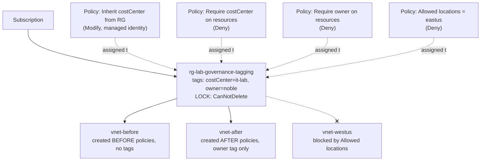

# Governance and tagging

## What this lab is

Every Azure resource can carry **tags**: short `name = value` labels such as
`owner = noble` or `costCenter = it-lab`. Tags are how a real organisation
answers "who owns this, who pays for it, and can it be deleted?" across
thousands of resources.

Tags only work if everyone applies them, and people forget. **Azure Policy**
is the enforcement layer: rules that Azure checks every time something is
created or changed. A policy can block a request (Deny), quietly fix it
(Modify), or just report it (Audit). **Resource locks** sit alongside policy
and stop anyone, including an Owner, from deleting or changing something by
accident.

This lab builds all three on one resource group and watches how they behave
together.

## Question

Three things this lab sets out to answer:

1. **Do tags on a resource group flow down to the resources inside it?**
   If not, what does it take to make them?
2. **What happens to resources that already existed before a policy was
   assigned?** Are they blocked, deleted, fixed, or left alone?
3. **If one policy adds a tag and another policy denies resources that are
   missing that same tag, which one wins?**

### Predictions (written before building)

| # | My prediction | What actually happened |
|---|---|---|
| 1 | No. Nothing has been assigned that copies tags down, so a new resource starts with no tags. |  |
| 2 |  |  |
| 3 |  |  |

## Key ideas, from zero

| Term | Plain meaning |
|---|---|
| **Scope** | Where a rule applies. Azure nests them: management group > subscription > resource group > resource. A rule set at one level applies to everything below it. |
| **Policy definition** | The rule itself, written in JSON. Azure ships hundreds of built-in ones. |
| **Policy assignment** | Attaching a definition to a scope, with its parameters filled in (for example, *which* tag name to require). |
| **Effect** | What the policy does when the rule matches: `Deny` blocks the request, `Modify` changes it, `Audit` only reports it. |
| **Compliance** | Azure's report of which existing resources break which assigned policies. |
| **Remediation task** | A job that goes back and applies a `Modify` policy to resources that existed before it was assigned. |
| **Managed identity** | An identity Azure creates for the policy assignment itself, so the policy has permission to edit resources. `Modify` policies need one; `Deny` and `Audit` do not. |
| **Resource lock** | `CanNotDelete` (can change, cannot delete) or `ReadOnly` (cannot change or delete). Locks override role permissions. |

## Architecture


This lab has no network traffic to draw. What matters is **scope**: where each
rule is attached and what it reaches. So, unlike the other labs, the diagram
*does* show the subscription and resource group, because here they are the
architecture.

`diagrams/reference.drawio` is a reference layout with the Azure icon set.
`diagrams/architecture.drawio` is drawn by hand from it, as the learning
exercise.



## What gets built

| Resource | SKU / size | Why it's here |
|---|---|---|
| Resource group `rg-lab-governance-tagging` | n/a | The scope every policy is assigned to |
| 4 policy assignments | Built-in definitions | The rules being tested |
| System-assigned managed identity | n/a | Lets the Modify policy write tags |
| `CanNotDelete` lock | n/a | Shows locks beat permissions |
| `vnet-before` | Virtual network, free | Stands in for a resource that predates the rules |
| `vnet-after` | Virtual network, free | A resource created under the rules |

Virtual networks are used because they cost nothing to keep and are created in
seconds. The lab is about the rules, not the resource.

### The four policies

| # | Built-in definition | Effect | Parameter |
|---|---|---|---|
| P1 | Inherit a tag from the resource group if missing | Modify | Tag name: `costCenter` |
| P2 | Require a tag on resources | Deny | Tag name: `costCenter` |
| P3 | Require a tag on resources | Deny | Tag name: `owner` |
| P4 | Allowed locations | Deny | `East US` |

P1 and P2 deliberately target the same tag. That is how question 3 gets
answered.

## Build it in the portal

<!-- Filled in step by step as the lab is built. Decisions, not clicks. -->

### 1. Confirm the right role

P1 is a `Modify` policy, so Azure gives it a managed identity and grants that
identity a role on the resource group. Granting roles needs `Owner` or
`User Access Administrator`; a `Contributor` can build everything else in this
lab but would fail at that one step.

**Subscriptions > (subscription) > Access control (IAM) > View my access**
showed `Owner` on both lab subscriptions.


The access panel lists `Owner` twice at "This resource". Two separate
assignments of the same role are harmless: permissions add up, they do not
double. It is still the kind of duplicate an access review would flag for
cleanup.

### 2. Create the resource group with its tags

`rg-lab-governance-tagging` in **East US**, in the dev subscription, with six
tags. Two of them do real work later: `costCenter` is the value P1 copies down
to resources, and `owner` is the tag P3 demands.


The Tags page states two rules worth remembering. **Tag names are not case
sensitive; tag values are.** `Owner` and `owner` are the same tag, but
`it-lab` and `IT-Lab` are different values, and a cost report grouped by
value will split them. It also warns that tag data is replicated globally, so
a tag must never hold anything secret or personal.

## Break it

<!--
Planned breaks:
  - Create a VNet with no tags: does P2 deny it, or does P1 rescue it?
  - Create a VNet with no owner tag: P3 should deny. Record the exact error.
  - Create a VNet in West US: P4 should deny.
  - Run a remediation task on vnet-before while P3 is still assigned: does
    the remediation succeed, given vnet-before has no owner tag?
  - Try to delete the resource group with the lock still on.
-->

## Rebuild it as code

Export the portal's template first to see what Azure created:

```bash
az group export --name rg-lab-governance-tagging > exported-reference.json
```

Then write `bicep/main.bicep` yourself and deploy to a clean group:

```bash
az group create --name rg-lab-governance-tagging-iac --location eastus \
  --tags environment=lab purpose=lab lab=governance-tagging autoDelete=true

az deployment group create \
  --resource-group rg-lab-governance-tagging-iac \
  --template-file bicep/main.bicep
```

## What I found

<!--
The answer to the three questions above, in your own words. Include anything
that surprised you, anything the documentation got wrong or left out, and the
one sentence you would want to read back before the exam.
-->

## Exam relevance

AZ-104 domain **Manage Azure identities and governance**: manage tags,
implement and manage Azure Policy, configure resource locks, manage resource
groups.

<!-- After the build: what a question on this looks like. -->

## Cost

Nothing. Azure Policy, tags, locks, resource groups and virtual networks are
all free. This is the one lab that can be left running without worry.

## Teardown

The lock has to come off first, or the delete fails. That is the point of a
lock.

```bash
az lock delete --name lock-no-delete --resource-group rg-lab-governance-tagging
az group delete --name rg-lab-governance-tagging --yes --no-wait
az group delete --name rg-lab-governance-tagging-iac --yes --no-wait
```

Policy assignments and role assignments scoped to the resource group go with
it when it is deleted. Confirm under **Policy > Assignments** that nothing is
left behind.
