# Governance and tagging


*Three real requests from this lab, run through four policies in the order
Azure evaluates them: Modify first, then every Deny. One is created, two are
refused. Built by [`scripts/diagrams/lab01_policy_flow.py`](../scripts/diagrams/lab01_policy_flow.py);
video versions: [landscape](diagrams/policy-flow.mp4) ·
[vertical](diagrams/policy-flow-vertical.mp4).*

## What this lab is

Every Azure resource can carry **tags**: short `name = value` labels such as
`owner = noble` or `costCenter = it-lab`. Tags are how a real organisation
answers "who owns this, who pays for it, and can it be deleted?" across
thousands of resources.

Tags only work if everyone applies them, and people forget. **Azure Policy**
is the enforcement layer: rules that Azure checks every time something is
created or changed. A policy can block a request (Deny), quietly fix it
(Modify), or just report it (Audit). **Resource locks** sit alongside policy
and stop anyone, including an Owner, from deleting or changing something by
accident.

This lab builds all three on one resource group and watches how they behave
together.

## Question

Three things this lab sets out to answer:

1. **Do tags on a resource group flow down to the resources inside it?**
   If not, what does it take to make them?
2. **What happens to resources that already existed before a policy was
   assigned?** Are they blocked, deleted, fixed, or left alone?
3. **If one policy adds a tag and another policy denies resources that are
   missing that same tag, which one wins?**

### Predictions (written before building)

| # | My prediction | What actually happened |
|---|---|---|
| 1 | No. Nothing has been assigned that copies tags down, so a new resource starts with no tags. | Correct. `vnet-before` was created with no tags (step 3). |
| 2 | A new policy is not retroactive: existing resources are left as they are. | Correct for changes: `vnet-before` kept no tags. But it is not ignored either: compliance evaluation lists it as non-compliant within minutes (step 4). Fixing it takes a remediation task. |
| 3 | P1 adds the tag before P2 checks, so the network is allowed. | Correct. Modify runs before Deny (Test A); with P1 off, P2 blocked the same request (Test B). |

## Key ideas, from zero

| Term | Plain meaning |
|---|---|
| **Scope** | Where a rule applies. Azure nests them: management group > subscription > resource group > resource. A rule set at one level applies to everything below it. |
| **Policy definition** | The rule itself, written in JSON. Azure ships hundreds of built-in ones. |
| **Policy assignment** | Attaching a definition to a scope, with its parameters filled in (for example, *which* tag name to require). |
| **Effect** | What the policy does when the rule matches: `Deny` blocks the request, `Modify` changes it, `Audit` only reports it. |
| **Compliance** | Azure's report of which existing resources break which assigned policies. |
| **Remediation task** | A job that goes back and applies a `Modify` policy to resources that existed before it was assigned. |
| **Managed identity** | An identity Azure creates for the policy assignment itself, so the policy has permission to edit resources. `Modify` policies need one; `Deny` and `Audit` do not. |
| **Resource lock** | `CanNotDelete` (can change, cannot delete) or `ReadOnly` (cannot change or delete). Locks override role permissions. |

### How the layers fit together

```
Microsoft account            who you are
  └─ Directory (tenant)      users, groups, directory roles
       └─ Tenant Root Group  top management group
            └─ Subscription  billing boundary
                 └─ Resource group
                      └─ Resources
```

Azure has **two separate sets of roles**, and they do not overlap:

| | Directory roles | Azure roles (RBAC) |
|---|---|---|
| Example | Global Administrator | Owner, Contributor, Reader |
| Controls | Users, groups, licences, sign-in | Subscriptions, resource groups, resources |
| Set in | Entra ID > Roles and administrators | Access control (IAM) on the scope |

A Global Administrator cannot build a virtual network by default, and an Owner
cannot create users. Azure roles, policies and locks all flow **down** the
layers from the scope they are set on.

A subscription created by signing up with a personal Microsoft account (an
Outlook or Gmail address) places that account in its new directory as an
external user, written `name_domain.com#EXT#@tenant.onmicrosoft.com`. It is the
same account, recorded as a pointer to an identity that lives outside the
directory. Deleting that entry does not delete the Microsoft account; it
removes its access to everything in the directory.

## Architecture

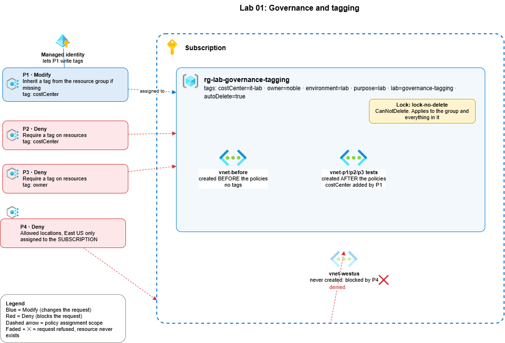

This lab has no network traffic to draw. What matters is **scope**: where each
rule is attached and what it reaches. So, unlike the other labs, the diagram
*does* show the subscription and resource group, because here they are the
architecture.

`diagrams/reference.drawio` is a reference layout with the Azure icon set.
`diagrams/architecture.drawio` is drawn by hand from it, as the learning
exercise.

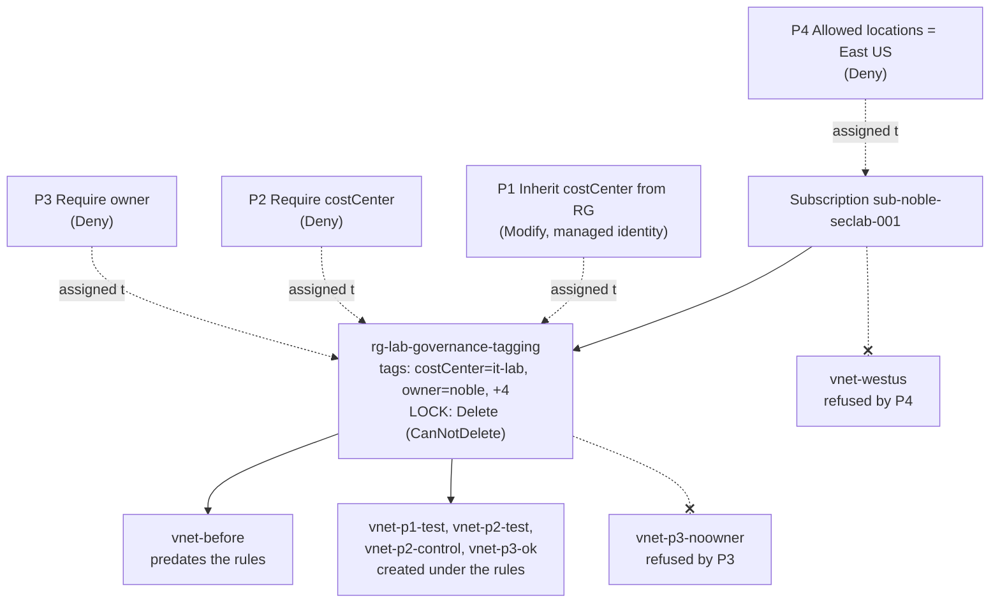

## What gets built

| Resource | SKU / size | Why it's here |
|---|---|---|
| Resource group `rg-lab-governance-tagging` | n/a | The scope P1 to P3 are assigned to (P4 sits on the subscription) |
| 4 policy assignments | Built-in definitions | The rules being tested |
| System-assigned managed identity | n/a | Lets the Modify policy write tags |
| `CanNotDelete` lock | n/a | Shows locks beat permissions |
| `vnet-before` | Virtual network, free | Stands in for a resource that predates the rules |
| `vnet-p1-test`, `vnet-p2-test`, `vnet-p2-control`, `vnet-p3-ok` | Virtual networks, free | One per test, created under the rules |

Virtual networks are used because they cost nothing to keep and are created in
seconds. The lab is about the rules, not the resource.

### The four policies

| # | Built-in definition | Effect | Parameter |
|---|---|---|---|
| P1 | Inherit a tag from the resource group if missing | Modify | Tag name: `costCenter` |
| P2 | Require a tag on resources | Deny | Tag name: `costCenter` |
| P3 | Require a tag on resources | Deny | Tag name: `owner` |
| P4 | Allowed locations | Deny | `East US`, assigned to the **subscription** |

P1 and P2 deliberately target the same tag. That is how question 3 gets
answered.

## Build it in the portal

<!-- Filled in step by step as the lab is built. Decisions, not clicks. -->

### 1. Confirm the right role

P1 is a `Modify` policy, so Azure gives it a managed identity and grants that
identity a role on the resource group. Granting roles needs `Owner` or
`User Access Administrator`; a `Contributor` can build everything else in this
lab but would fail at that one step.

**Subscriptions > (subscription) > Access control (IAM) > View my access**
showed `Owner` on both lab subscriptions.

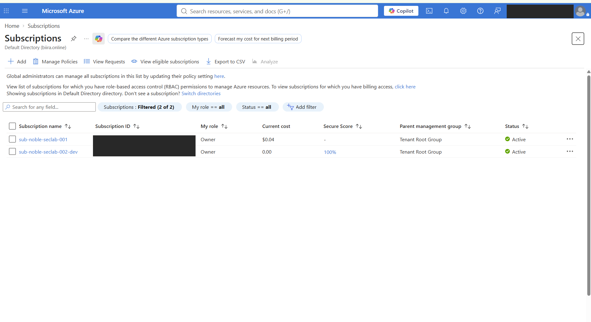

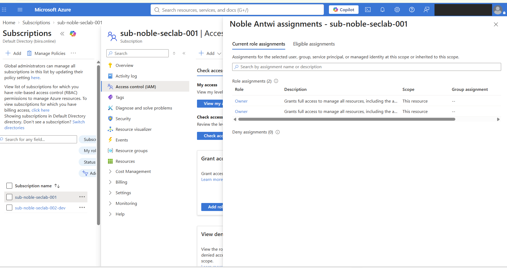

The access panel lists `Owner` twice at "This resource". Two separate
assignments of the same role are harmless: permissions add up, they do not
double. It is still the kind of duplicate an access review would flag for
cleanup.

### 2. Create the resource group with its tags

`rg-lab-governance-tagging` in **East US**, in `sub-noble-seclab-001`, with six
tags. Two of them do real work later: `costCenter` is the value P1 copies down
to resources, and `owner` is the tag P3 demands.

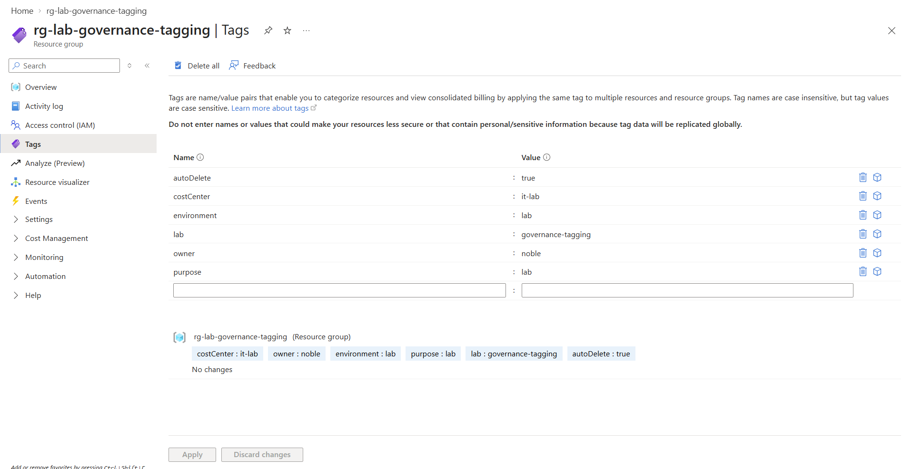

The Tags page states two rules worth remembering. **Tag names are not case
sensitive; tag values are.** `Owner` and `owner` are the same tag, but
`it-lab` and `IT-Lab` are different values, and a cost report grouped by
value will split them. It also warns that tag data is replicated globally, so
a tag must never hold anything secret or personal.

### 3. Create vnet-before with no tags

`vnet-before` in the same group and region, with the portal's default address
space `10.0.0.0/16` and one subnet `default` at `10.0.0.0/24`. Everything on
the **Security** tab stays off: Bastion, Azure Firewall and DDoS Network
Protection all bill whether or not anything uses them, and DDoS Network
Protection runs to thousands of dollars a month. The **Tags** tab is left
empty on purpose.

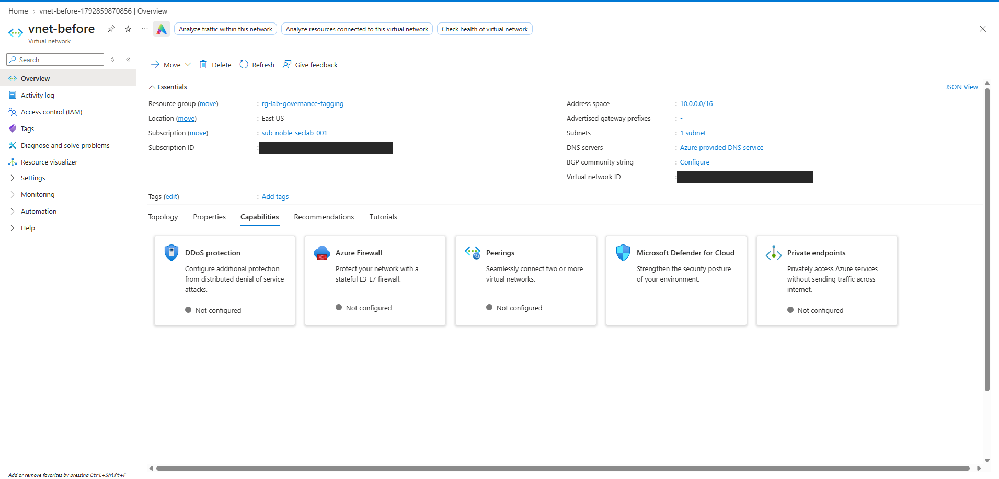

**Tags: Add tags.** The network sits inside a group carrying six tags and has
none of them. Prediction 1 held: a resource group's tags describe the group
only. Nothing copies them to the resources inside until a policy is assigned
to do it.

### 4. Assign the policies

**Policy > Assignments** was not empty before this lab assigned anything. Each
subscription already carried an initiative called **ASC Default**: Microsoft
Defender for Cloud assigns its default security benchmark to every
subscription automatically. Its effects only audit (report), so it never
blocks a request, and it is the source of the non-compliant count on the
Policy overview before any lab rule existed.

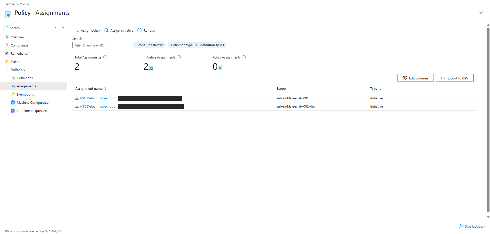

An **initiative** is a bundle of policy definitions assigned as one. This lab
assigns single policies instead, so each rule's effect can be watched on its
own.

Portal gotcha: the **Policy definition** picker stays empty ("No policies
found") until **Scope** is set and confirmed with **Select**. Closing the scope
panel any other way leaves the field blank.

#### P1: inherit costCenter (Modify)

Scope `sub-noble-seclab-001/rg-lab-governance-tagging`, definition **Inherit a
tag from the resource group if missing**, version `1.*.*` (take minor
updates automatically, never a new major version), Tag Name `costCenter`.

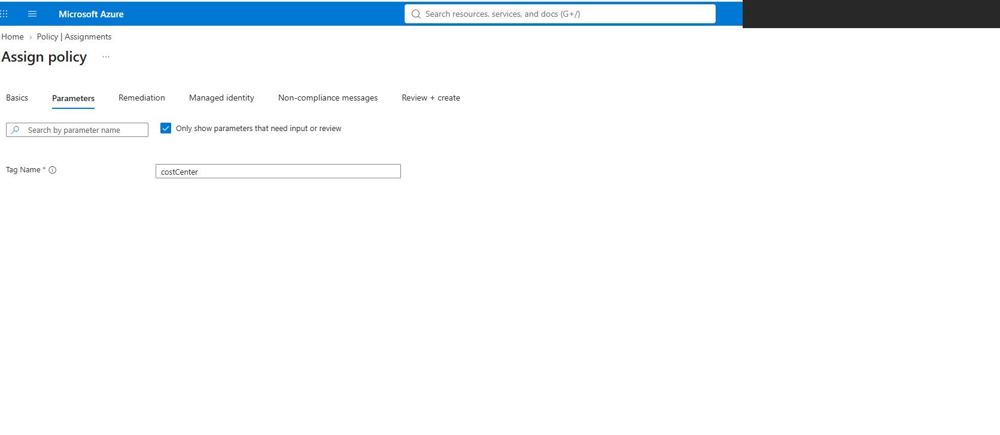

The **Remediation** tab says it plainly: by default an assignment only takes
effect on newly created resources, and existing ones are updated through a
remediation task. The task is left off here on purpose, so the old network
shows up as non-compliant first.

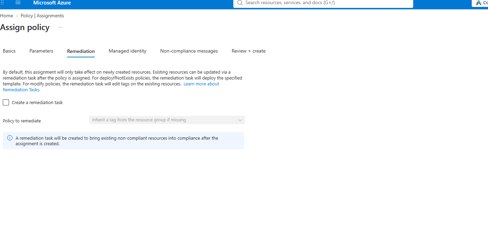

The **Managed identity** tab creates a system-assigned identity in East US
and grants it **Contributor** on the resource group, because that is the role
the built-in definition asks for.

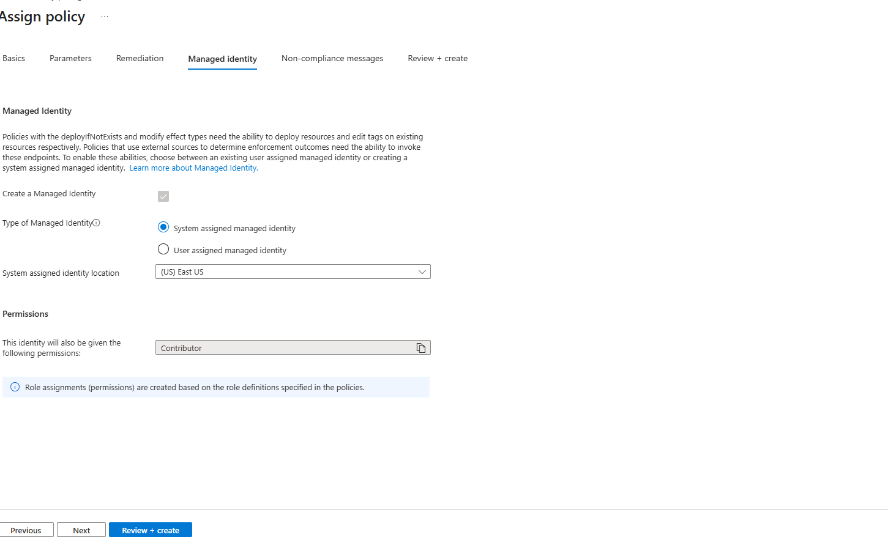

A managed identity is an identity for a thing rather than a person. Nothing in
Azure changes a resource unless some identity with permission makes the
change, and P1 has to act when nobody is signed in. Azure holds and rotates
its credential, so there is no password to leak. **System assigned** means it
lives and dies with this one assignment; **user assigned** would be a
standalone identity that several things can share.

**Least-privilege note.** P1 only ever edits tags, and the built-in
**Tag Contributor** role covers exactly that. Contributor can create, change
and delete anything in the group. The scope is one resource group, so the
exposure is small, but it is the over-permissioned non-human identity an
access review exists to catch.

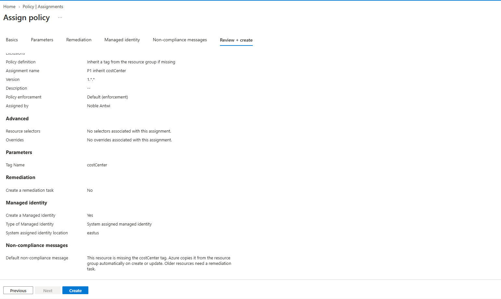

**Result.** Within minutes, **Policy > Compliance** listed `P1 inherit
costCenter` as non-compliant, and drilling in showed exactly one resource:
`vnet-before`. The network was not changed and not deleted. It was reported.

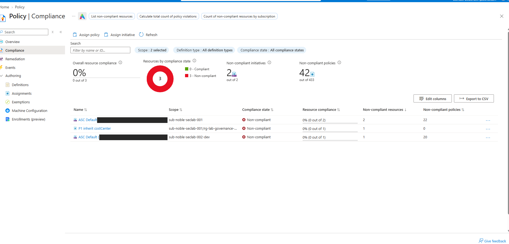

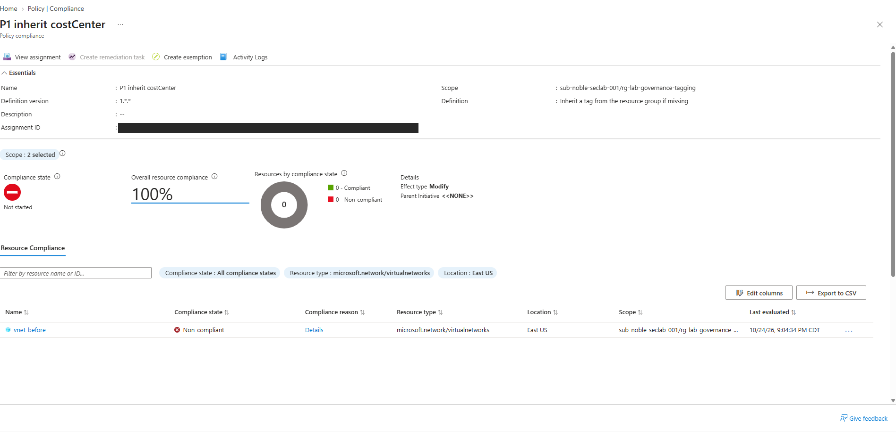

The P1 page itself still read *Not started* and *100%* while its own list
already showed `vnet-before` evaluated as non-compliant. The summary tiles
trail the per-resource results; refreshing a few minutes later brings them in
line. **Create remediation task** stays greyed out until they do.

#### Testing P1 on its own

The plan first had every rule assigned before any new network was created.
That would leave two rules able to touch the same tag, with no way to tell
which one acted. Testing each rule as soon as it exists changes one thing at a
time, so P1 got its own test before P2 existed.

`vnet-p1-test`, address space `10.1.0.0/16` with subnet `default`
`10.1.0.0/24` (kept apart from `vnet-before` so the two could later be peered
without overlap), and **no tags** entered.

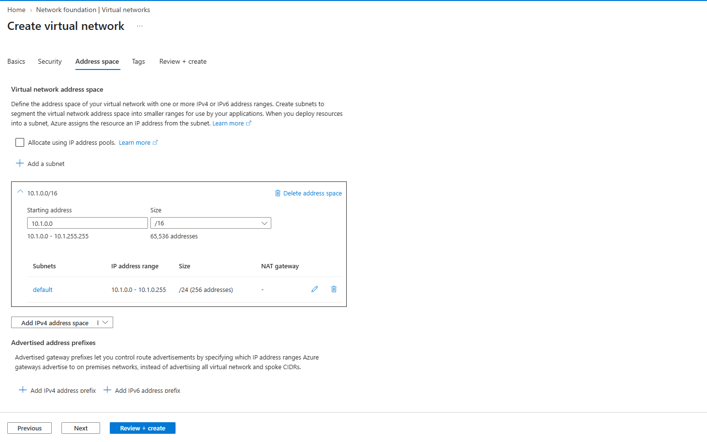

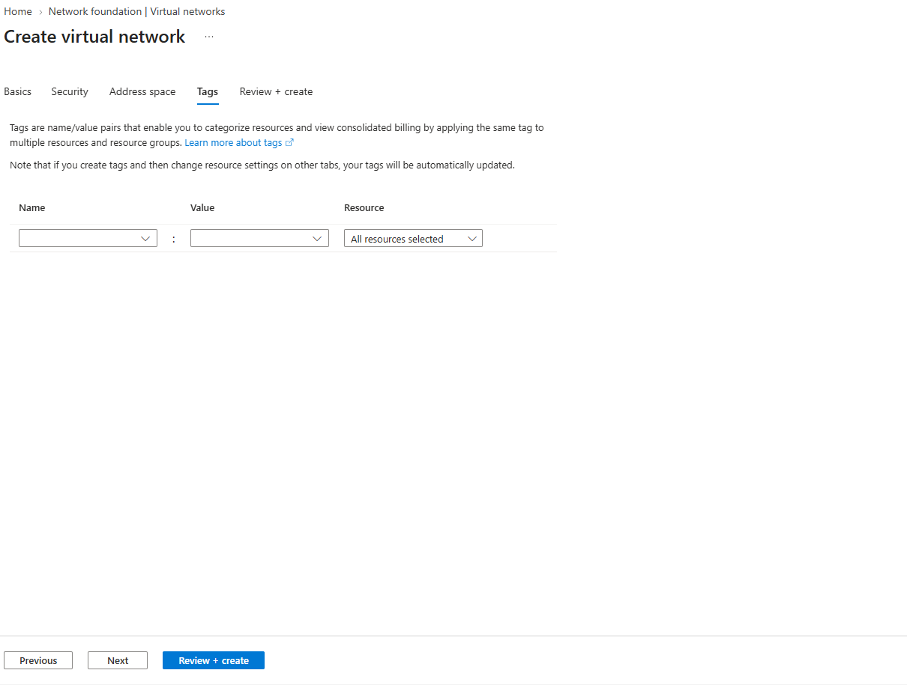

Once created, its Tags page showed `costCenter : it-lab`. Nobody typed it. P1
rewrote the create request on the way in, before the network existed.

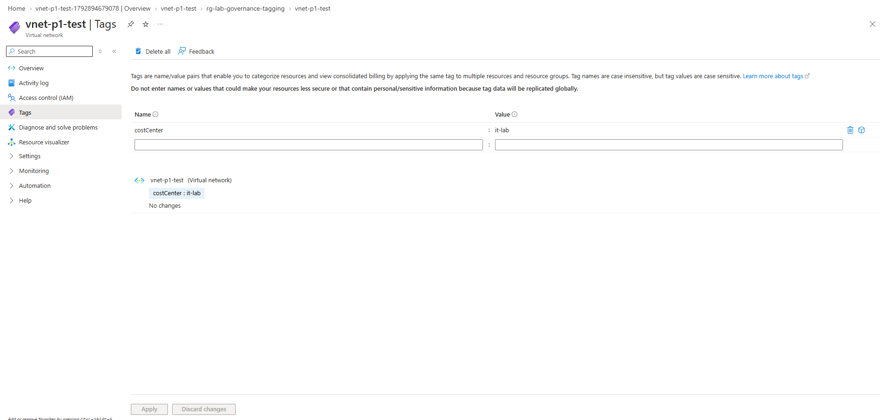

It carries **only** `costCenter`. The group's other five tags did not come
with it, because P1 was assigned for one tag name. Inheriting five tags would
take five assignments, or one initiative that bundles them.

The network did not appear under **Policy > Compliance** straight away, even
though the tag was there at once. Those are two different mechanisms: a
`Modify` effect acts *inside* the request, instantly, while compliance results
come from a separate evaluation that reports a new resource some minutes after
it is created.

#### P2: require costCenter (Deny)

Searching the definition picker for `Require` returns hundreds of rules,
because the search also matches descriptions. Filtering **Category** to
**Tags** cuts it to four:

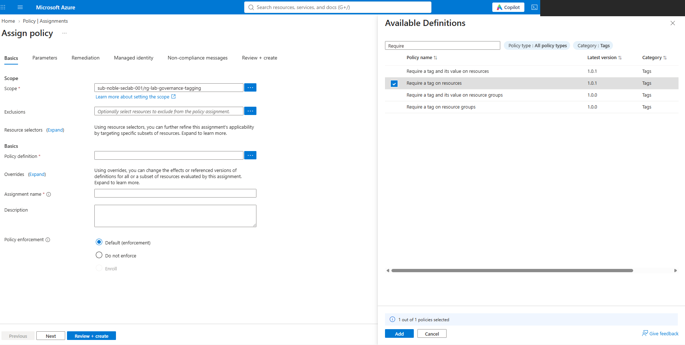

| Built-in | Checks | Applies to |
|---|---|---|
| Require a tag on resources | the tag **exists**, any value | resources |
| Require a tag and its value on resources | the tag exists **with one exact value** | resources |
| Require a tag on resource groups | the tag exists | resource groups only |
| Require a tag and its value on resource groups | exact value | resource groups only |

P2 is the first one: `costCenter` must be present, whatever its value. The
"and its value" variant would also block a network in a different cost centre.
The resource-group variants exist because the resource rules do not evaluate
resource groups at all.

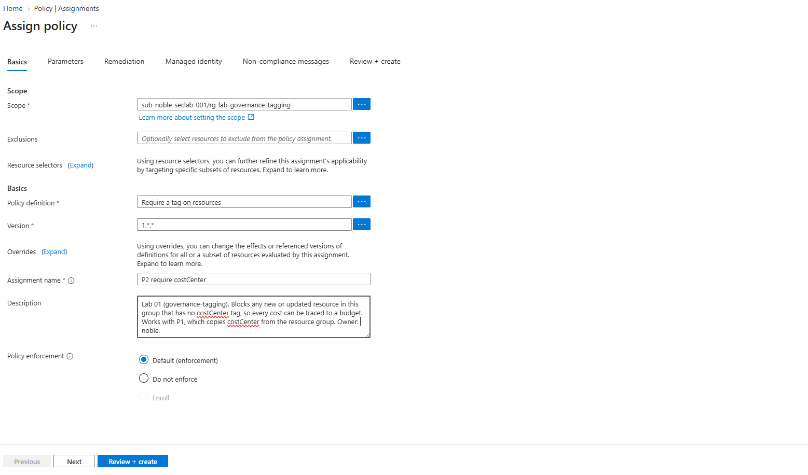

The **Description** is for admins reading the assignment later: what it does,
why, what it works with, who owns it. The **non-compliance message** is for
whoever gets blocked, so it says what is wrong and how to fix it.

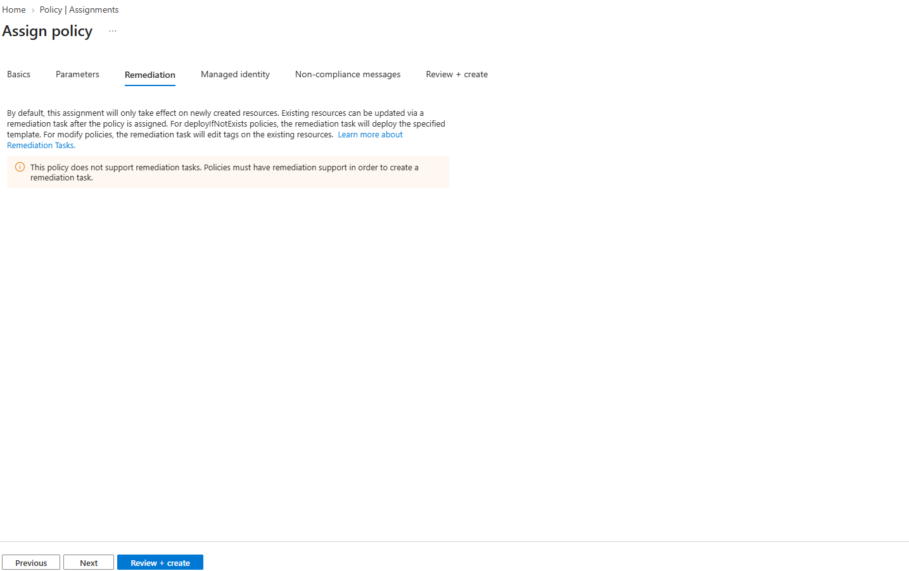

**"This policy does not support remediation tasks."** Only effects that know
the fix can go back and apply it: `Modify` (P1) and `DeployIfNotExists`.
`Deny` only refuses requests, and `Audit` only reports. P2 can block a network
with no `costCenter` but has no idea what value it should have.

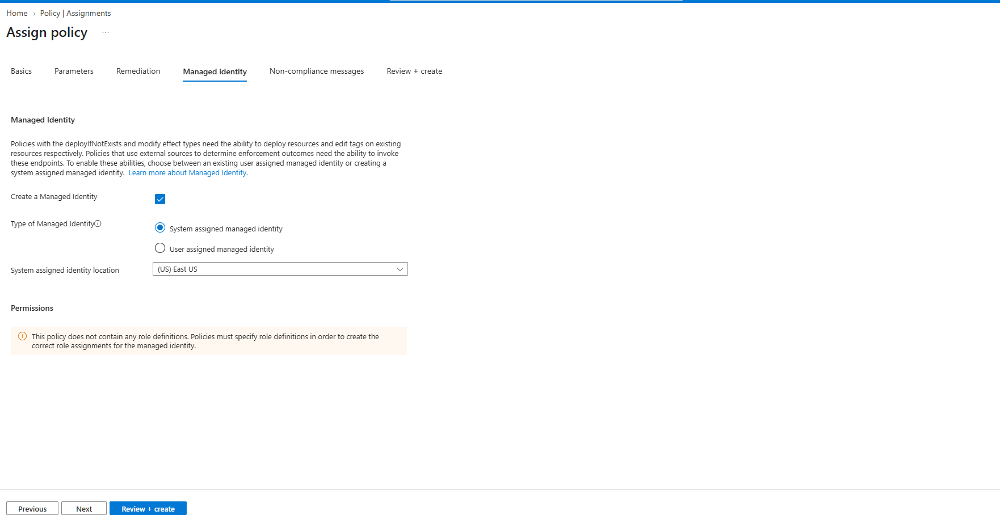

**Finding: an identity nobody needed.** The **Managed identity** tab was left
ticked, so P2 was created with a system-assigned identity even though the
portal itself warns that the policy "does not contain any role definitions".
The identity has no permissions and does nothing. It is still a non-human
identity sitting in the directory with no purpose, and identity sprawl of
exactly this kind is what access reviews have to clean up. It is removed
during the code stage with `az policy assignment identity remove`.

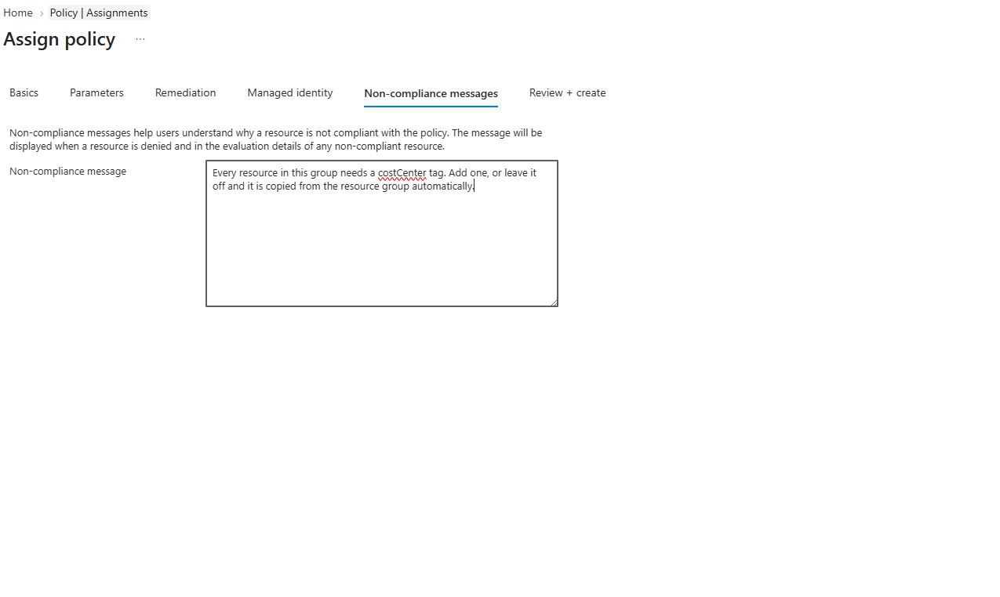

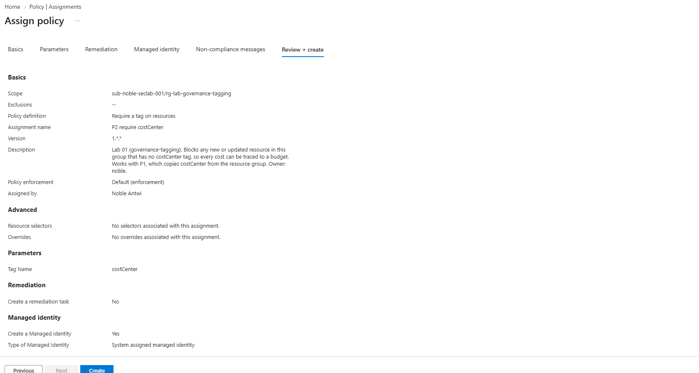

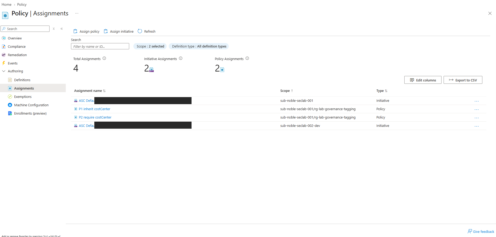

#### The order Azure evaluates effects in

Assignments have no priority over one another, and the order they were
created in does not matter. What decides the order is the **effect**. On every
create or update request, Azure Policy evaluates:

1. **Disabled** rules are skipped.
2. **Append** and **Modify** run and change the request.
3. **Deny** checks the *changed* request.
4. **Audit** records what it finds before the request goes to the resource
   provider.
5. After the resource provider succeeds, **AuditIfNotExists** and
   **DeployIfNotExists** run.

If any single Deny matches, the request fails. A Deny cannot be outvoted by
another assignment; only an **exemption** lets a resource past it.

#### Test A: P1 and P2 both on, no tags

Run at 10:15 PM, 38 minutes after P2 was assigned, so P2 had had time to take
effect. `vnet-p2-test`, address space `10.2.0.0/16`, Tags tab left empty.

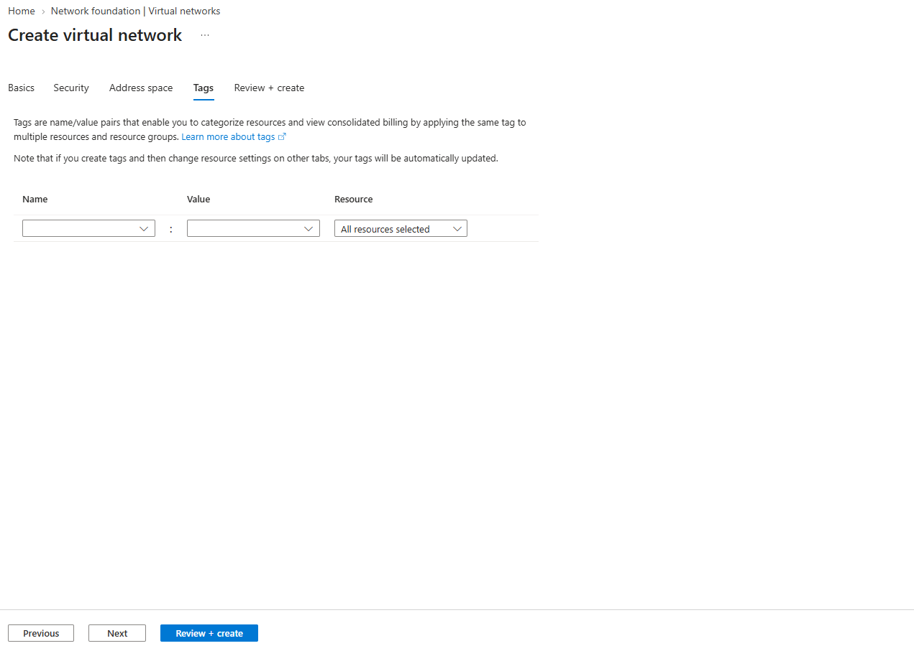

**Validation passed.** P2 did not object.

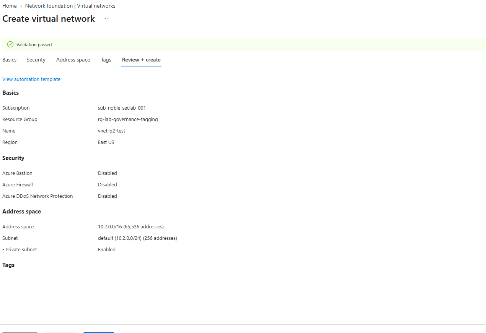

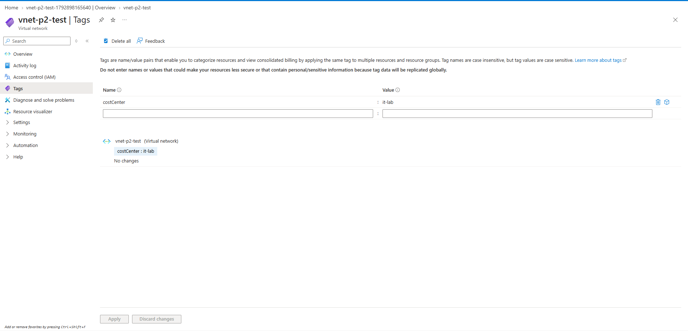

The network was created carrying `costCenter : it-lab`. P1 added the tag
first, so by the time P2 checked the request the tag was already there.

The intuition going in was that a block would win over everything else. It
does, but only over the request **as it stands after Modify has run**. Deny
never sees the original request the person typed. A Deny that targets a tag
some Modify policy supplies is therefore a backstop: it only fires if the
Modify is missing, disabled, or excluded.

By then the compliance view had caught up with `vnet-p1-test`: P1 and P2 each
showed **1 of 2** resources compliant. The non-compliant one in both is
`vnet-before`.

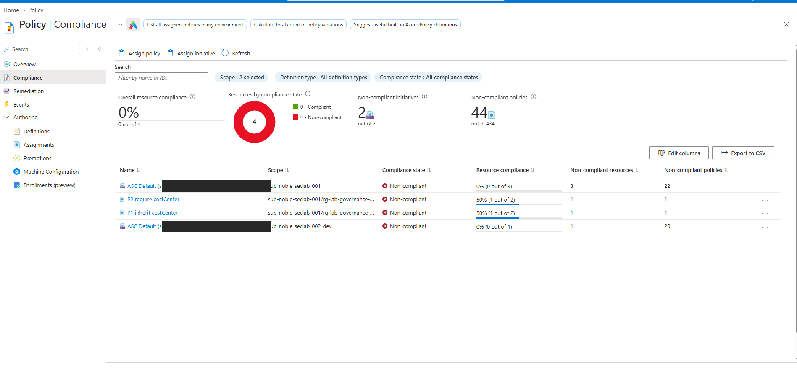

The overall tile stays at **0 out of 4** because a resource counts as compliant
only if it passes *every* assigned policy, and the ASC Default initiative
still flags all of them.

#### Test B: P1 switched off, P2 on its own

Test A passing had two possible explanations: P1 rescued the request, or P2
was not live yet. To rule out the second, P1's **Policy enforcement** was set
to **Do not enforce** at 10:35 PM. That mode keeps evaluating and reporting
compliance but stops the effect from acting.

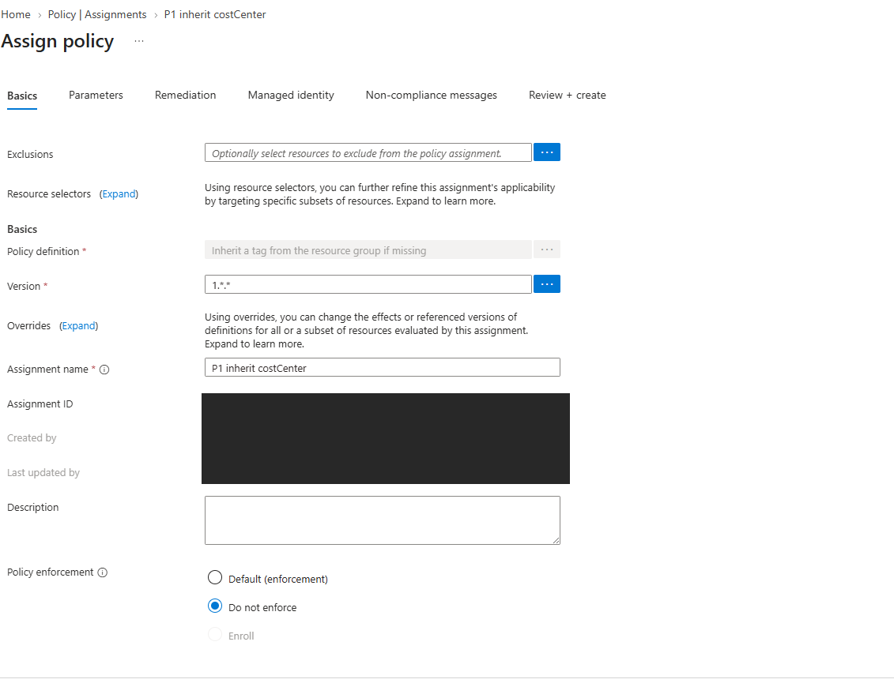

At 10:48 PM, `vnet-p2-control` (`10.3.0.0/16`, no tags) was tried. The portal's
own **Review + create** check said *Validation passed*:

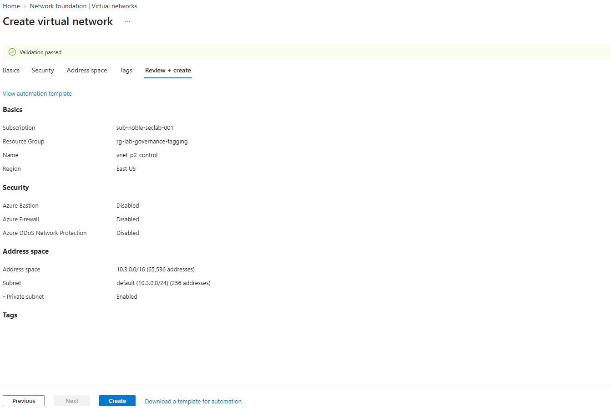

Then **Create** failed: *"The template deployment failed because of policy
violation."* The portal's form check does not run Azure Policy; the policy
check happens when the request reaches Azure Resource Manager.

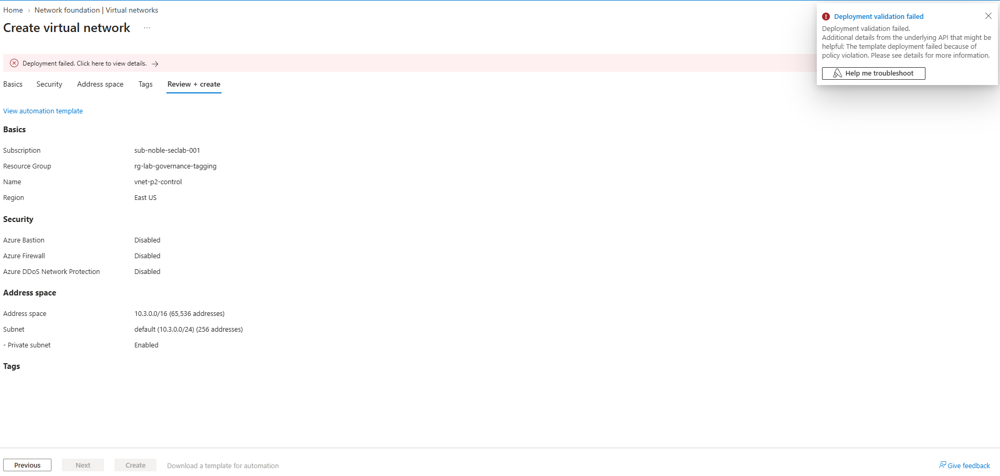

At 10:52 PM P1 went back to **Default (enforcement)**. The same network,
still with no tags, was created at 10:53 carrying `costCenter : it-lab`.
Turning the effect back on took effect within a minute; the 30-minute figure
is a worst case, not a fixed delay.

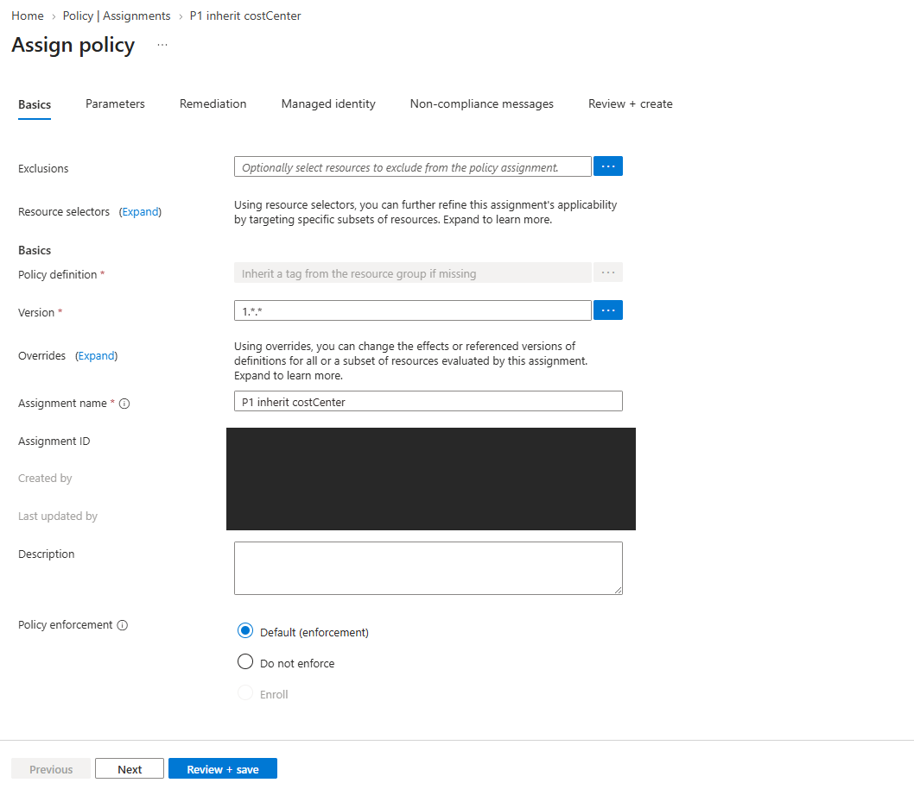

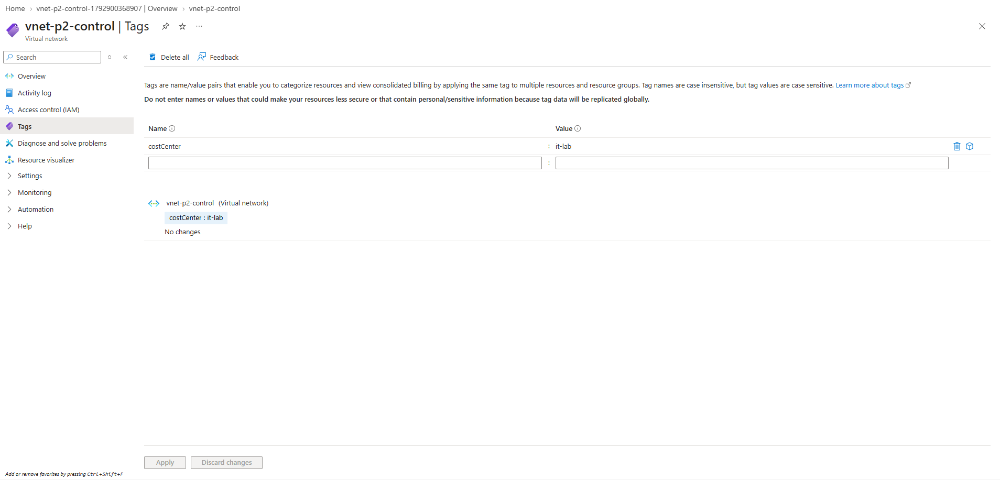

Together, Tests A and B answer question 3: P2 is live and does block, and the
only thing that got the untagged network past it was P1 adding the tag first.

**A design flaw P1 brings with it.** P1 stamps the group's `costCenter=it-lab`
on everything created without one, so a resource built by someone in finance
or marketing is billed to IT unless they think to override it. "If missing"
means anyone who supplies their own value keeps it, but the default is wrong
for everyone outside IT. Real tenants avoid this by giving each department its
own resource group (each carrying its own `costCenter`), or by requiring the
tag with an **allowed values** list instead of inheriting a single value.

#### P3: require owner (Deny)

Same built-in as P2, **Require a tag on resources**, with Tag Name `owner`.
The Tags category holds many more built-ins than the four "Require" ones:
add, append, inherit, and add-or-replace variants for resources, resource
groups and subscriptions.

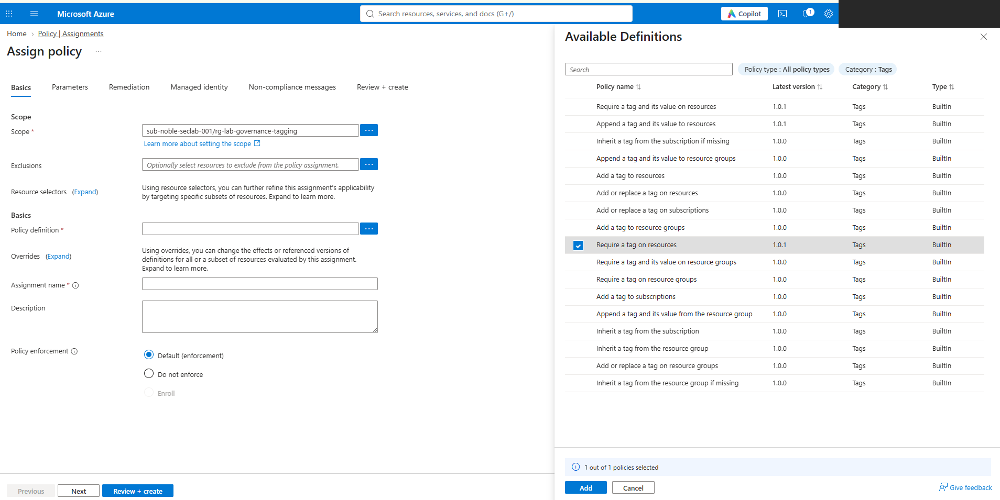

This time the **Create a Managed Identity** box was unticked, so P3 has no
identity, which is right for a Deny.

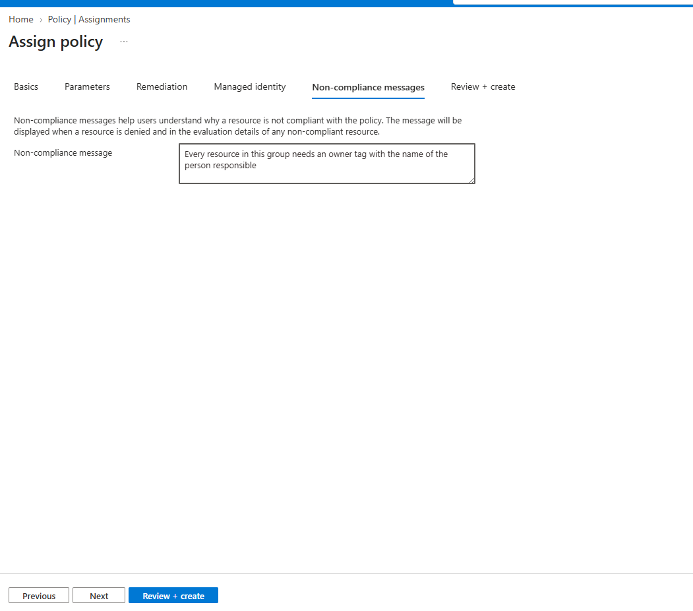

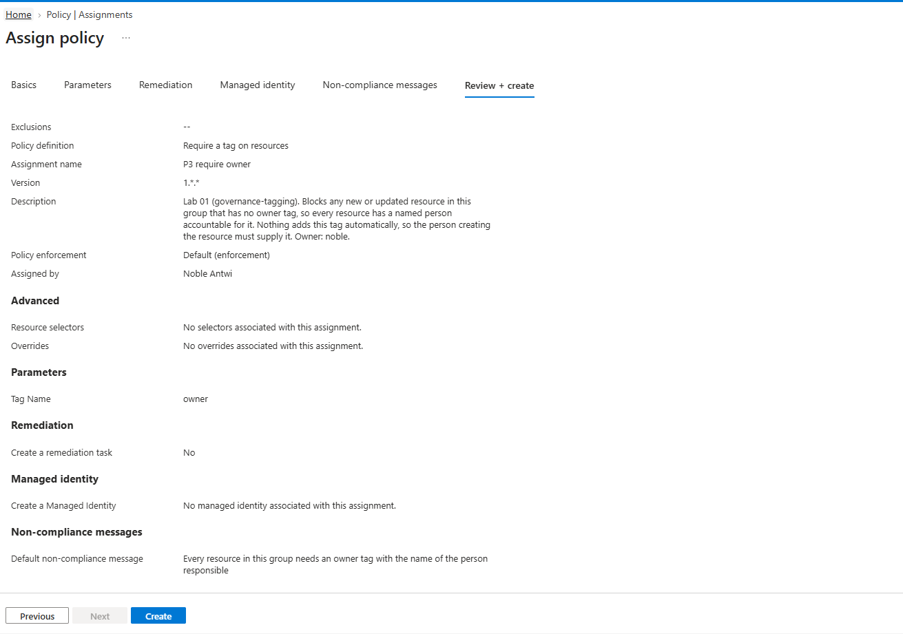

P1 and P3 look at **different tags**. P1 can only ever supply `costCenter`, so
nothing rescues a request that lacks `owner`: P3 is a plain Deny with no
Modify in front of it.

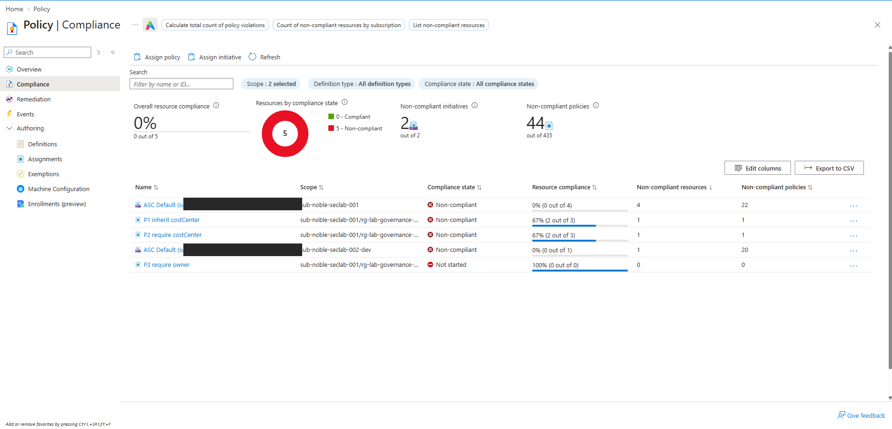

Straight after assignment P3 read *Not started*, *100% (0 out of 0)*: it had
not been evaluated against anything yet.

#### Testing P3

**The Tags tab warns before you submit.** While creating `vnet-p3-noowner`,
the portal's Tags tab showed P2's non-compliance message inline, with a
**Click here to set required tags** link. The portal reads the Deny policies on
the target scope and surfaces their messages in the form.

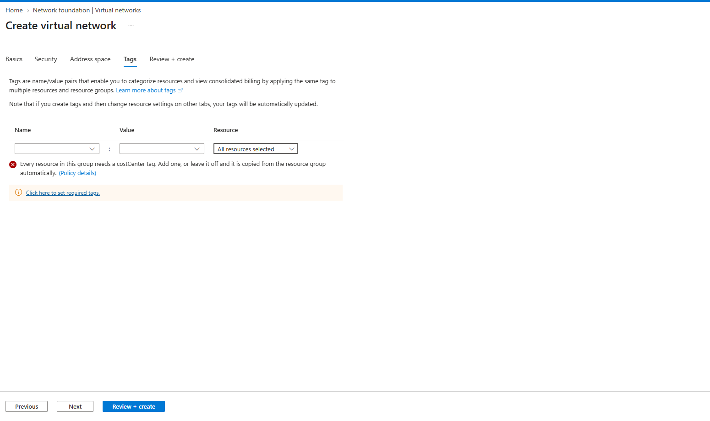

It still showed the costCenter warning with `owner=noble` entered:

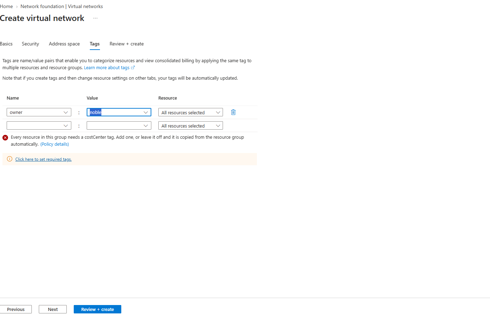

That warning is only advice. The form checks the Deny rule on its own and does
not know that P1 will add `costCenter` on the way in, so it warns about a tag
that will in fact be supplied. Only the real request, evaluated by Azure
Resource Manager, applies the effects in order.

**Where the full error lives.** `vnet-p3-noowner` (no tags) failed at Create,
and the portal's **Click here to view details** opened an empty *Errors* panel:
the request was refused at validation, before any deployment existed to hold an
error. The detail is in the resource group's **Activity log**. Under the failed
**Validate Deployment** entry sit two child events, in this order:

- **Modify**: Succeeded (P1 added `costCenter`)
- **'deny' Policy action**: Failed (P3 refused the request)

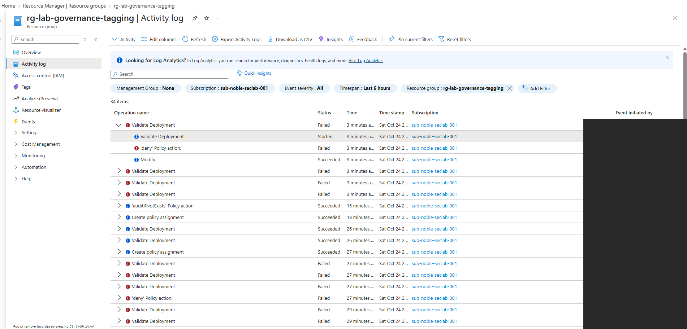

That is the evaluation order from the docs, recorded in the audit trail. The
entry's JSON carries the error code and the custom message:

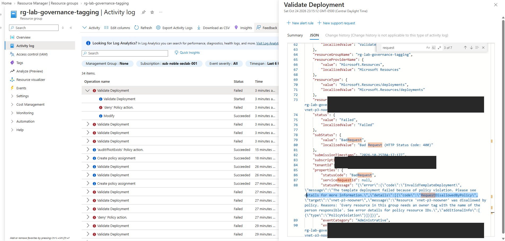

```
"code": "RequestDisallowedByPolicy",
"target": "vnet-p3-noowner",
"message": "Resource 'vnet-p3-noowner' was disallowed by policy. Reasons:
  'Every resource in this group needs an owner tag with the name of the
  person responsible'."
```

`RequestDisallowedByPolicy` is the code to search for whenever a deployment
fails on policy.

**`vnet-p3-ok`** (`10.5.0.0/16`, only `owner=noble` entered) was created and
ended up with **two** tags: the `owner` it was given and the `costCenter` P1
added. Every rule was satisfied, so nothing blocked it.

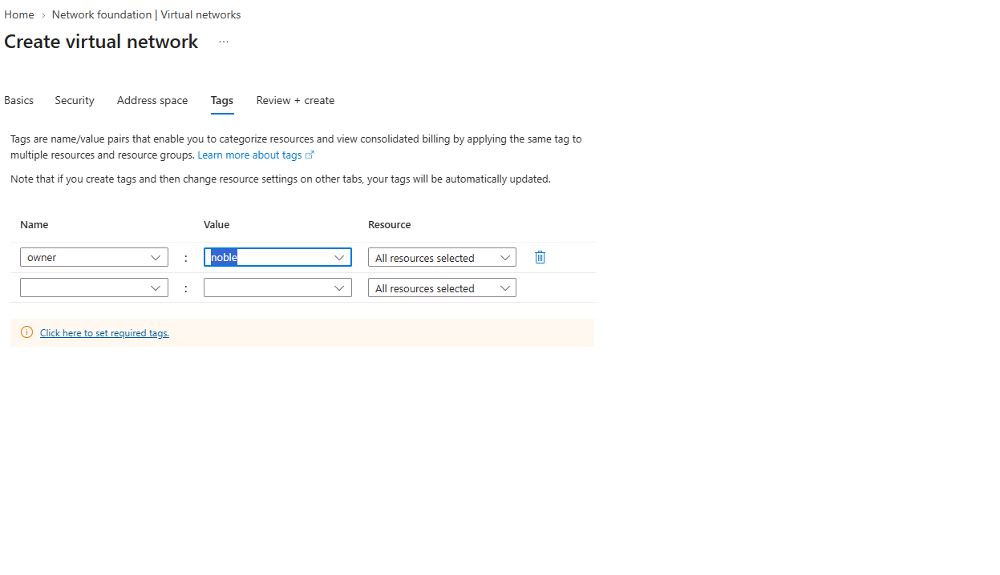

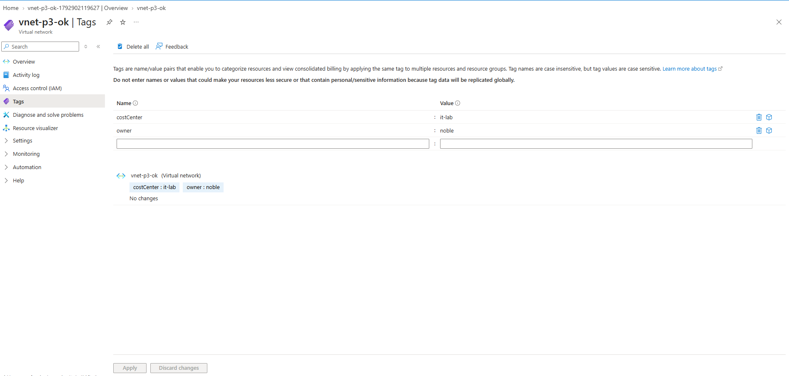

#### P4: allowed locations (Deny), at subscription scope

Searching definitions for `Allowed locations` shows the general rule beside
service-specific ones (Cosmos DB, SQL, IoT Hub, API Management) and a separate
**Allowed locations for resource groups**. The general rule checks resources
only; resource groups need the second one.

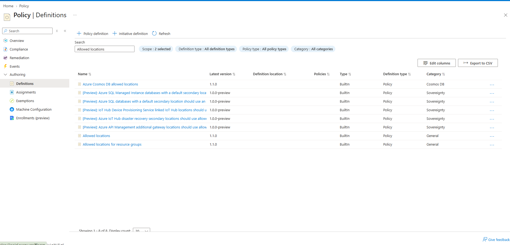

**Scope decision.** P1 to P3 sit on the resource group. P4 was deliberately
assigned to the **whole subscription** `sub-noble-seclab-001`, leaving the
resource group box empty, because a region rule only makes sense as a
tenant-wide guardrail. Consequences accepted with it:

- New resources anywhere in the subscription outside East US are refused.
- Existing resources elsewhere are reported, not removed.
- A later lab that needs a second region must add it to P4, or exclude its
  resource group, first.

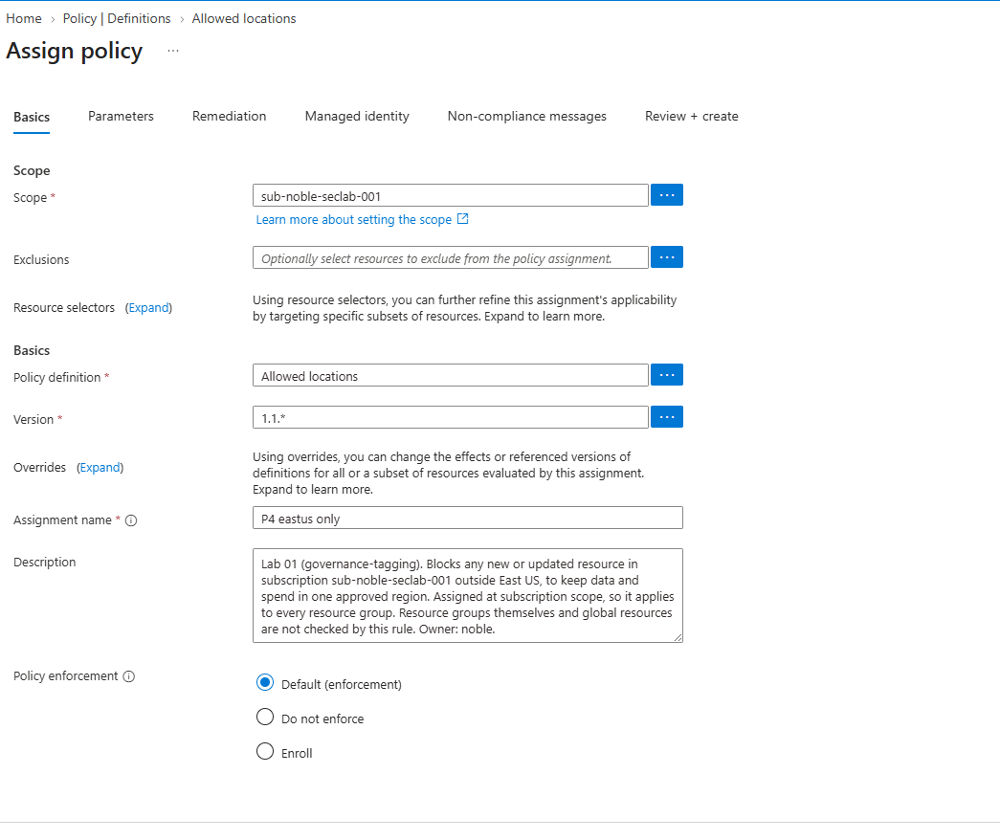

**Policy enforcement** has three modes:

| Mode | Effect on create/update | Use it for |
|---|---|---|
| **Default (enforcement)** | applied to every resource in scope | normal rules (all four here) |
| **Do not enforce** | not applied; compliance still reported | trying a rule out first (Test B) |
| **Enroll** | applied only to scopes that have opted in through an *enrollment* | rolling a rule out in batches across a large estate |

Enroll was greyed out for P1 to P3 but offered for P4.

Allowed locations set to **East US** only, no managed identity, and a message
written for subscription scope that tells the reader who can approve an
exception:

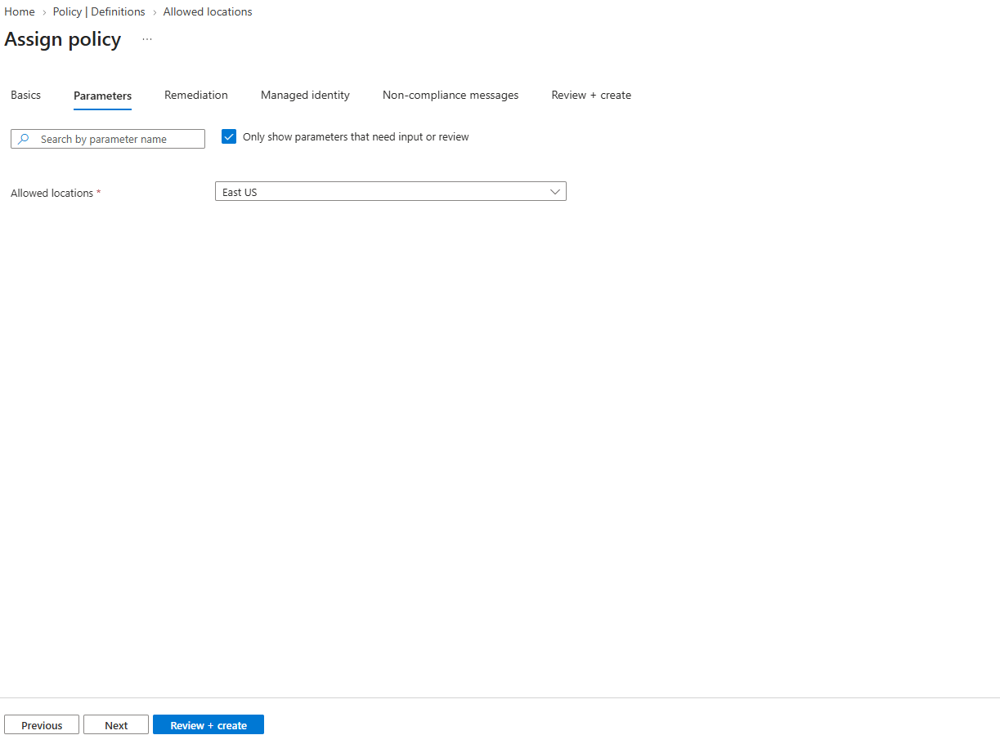

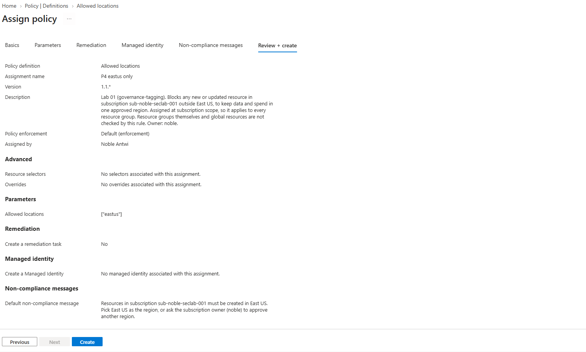

With all four rules in place, P4 read **Compliant, 6 of 6**: every existing
resource in the subscription was already in East US. P1 and P2 read 4 of 5
(only `vnet-before` lacks `costCenter`), and P3 1 of 5 (only `vnet-p3-ok`
carries `owner`; the earlier networks predate the rule and were never given
one).

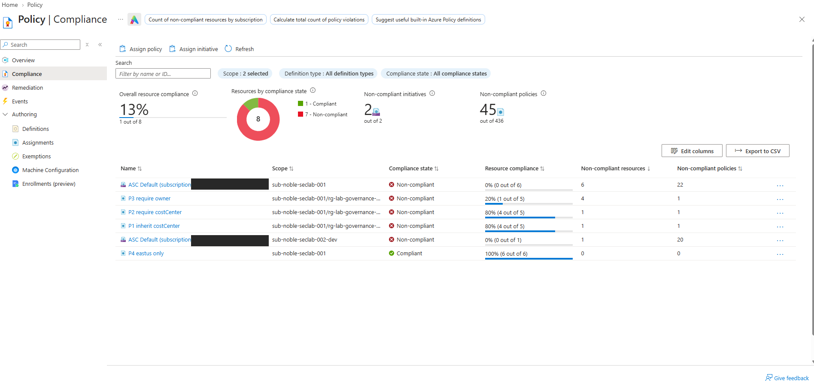

#### Testing P4

`vnet-westus`: **West US**, `10.6.0.0/16`, tag `owner=noble` so that P3 had
nothing to object to, leaving location as the only thing that could fail.

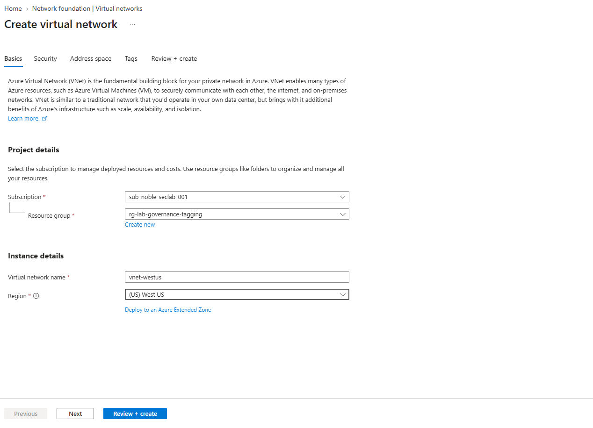

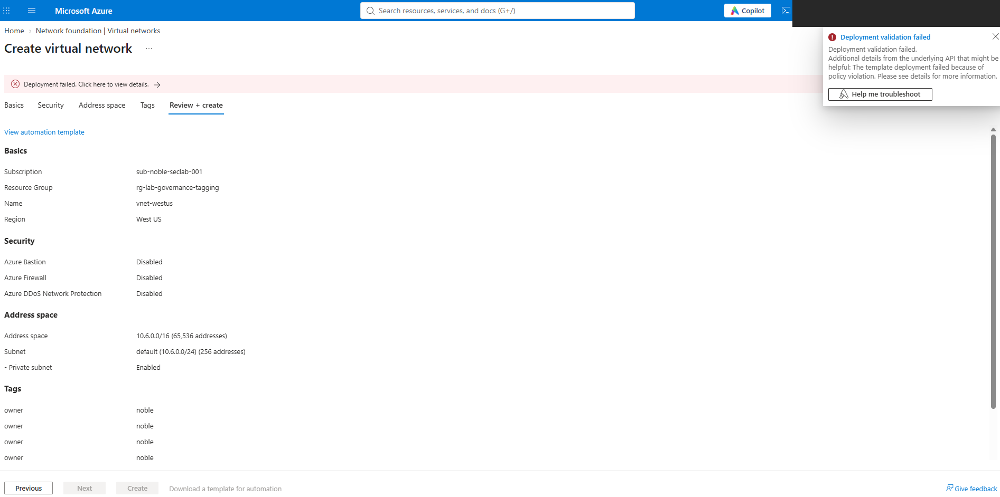

Because P4 sits on the subscription, its trail is in the **subscription's**
Activity log, not only the resource group's. Under the failed **Validate
Deployment**: **Modify** succeeded (P1 still added `costCenter`), then the
**'deny' Policy action** failed. The JSON names the target and carries the P4
message:


```
"code": "RequestDisallowedByPolicy", "target": "vnet-westus",
"message": "Resource 'vnet-westus' was disallowed by policy. Reasons:
  'Resources in subscription sub-noble-seclab-001 must be created in East US.
  Pick East US as the region, or ask the subscription owner (noble) to approve
  another region.'"
```

P1 modified a request that was then refused anyway. Modify always runs first;
it has no way of knowing a Deny further down will reject the result.

The same log shows **Register Microsoft Policy Insights Resource Provider**:
Azure registered the `Microsoft.PolicyInsights` provider on the subscription
the first time a policy was assigned there, which is what produces the
compliance data.

### 5. Remediate vnet-before

**Policy > Remediation** lists only P1. Remediation exists for effects that
know the fix (`Modify`, `DeployIfNotExists`); the three Deny rules have nothing
to apply. *Resources to Remediate: 1* is `vnet-before`. The assignment page's
**Create remediation task** button opens the same form.


The form restates P1's "if missing": *if the tag exists with a different
value it will not be changed.* Defaults kept: all locations, failure threshold
100%, resource count 500.


**The task failed.**


The `vnet-before` row's deployment error explains why:


```
PolicyRemediationFailure: Failed to remediate resource ... vnet-before.
The 'PATCH' request failed with status code: 'Forbidden'.
Inner Error: 'Resource 'vnet-before' was disallowed by policy. Reasons:
'Every resource in this group needs an owner tag with the name of the
person responsible'.'
```

A remediation task is not a back door. It applies its fix by sending an
ordinary update (`PATCH`) to the resource, and that update goes through every
assigned Deny rule like any other request. `vnet-before` has no `owner` tag,
so P3 refused the update that would have added `costCenter`.

The lesson for real tenants: rolling out a new Deny rule before cleaning up
existing resources can quietly break the remediation of an unrelated Modify
rule. Fix the old resources first, or exempt them while the remediation
runs.

### 6. Fix it by hand

On `vnet-before`'s Tags page, only `owner = noble` was added and applied.


Afterwards the network carried **both** `owner` and `costCenter`.


A second remediation task was started straight after, which made it look as
if the task had added `costCenter`. The Remediation page said otherwise:
**Resources to Remediate: 0**. There was nothing left for it to do.


The `vnet-before` Activity log settles it:


| When | Operation | Result | What happened |
|---|---|---|---|
| 00:22 | Modify → Write tags → 'deny' Policy action | Failed | the first remediation task's update, refused by P3 |
| 00:28:33 | Write tags → **Modify** | Succeeded | the manual edit; P1 added `costCenter` inside it |

The successful **Modify** was initiated by the signed-in user, not by P1's
managed identity: it ran inside the user's own tag update. Adding `owner`
satisfied P3, and the same request gave P1 its chance to add `costCenter`.
**Any update to a non-compliant resource triggers its Modify policies**, so
fixing the missing Deny tag fixed the Modify tag for free.

### 7. Lock the resource group

**Resource group > Settings > Locks > Add**: `lock-no-delete`, type
**Delete** (the portal's name for `CanNotDelete`), note *Lab 01: blocks
accidental deletion*.


The resource group list in the first screenshot also shows
**NetworkWatcherRG**, which this lab never created. Azure makes it, with a
Network Watcher for the region, automatically the first time a virtual network
is created in a subscription and region.

**Delete is blocked.** Deleting `vnet-p1-test` failed straight away, for the
Owner, because the group's lock applies to everything inside it:


**Changes are not.** The first attempt to add `test = 1` failed, but the error
named **P3 require owner**, not the lock: `vnet-p1-test` had no `owner` tag, so
any update to it was refused. The Tags page's own error panel names the policy
directly, which is quicker than the Activity log.


With `owner = noble` added in the same edit, the change went through under the
lock:


| Lock type | Change a resource | Delete a resource |
|---|---|---|
| **Delete** (`CanNotDelete`) | allowed | blocked |
| **Read-only** (`ReadOnly`) | blocked | blocked |

Locks bind everyone, Owners included; the only way past one is to remove it,
which needs `Microsoft.Authorization/locks/delete` permission (Owner or User
Access Administrator).

## Break it

Every break was run inside the build above. In one place:

| Attempt | Rules in play | Result | Refused by |
|---|---|---|---|
| `vnet-p2-test`, no tags | P1 + P2 | created, `costCenter` added | nothing |
| `vnet-p2-control`, no tags, P1 set to Do not enforce | P2 alone | refused | P2 |
| `vnet-p3-noowner`, no tags | P1 + P2 + P3 | refused | P3 |
| `vnet-westus`, owner tag, West US | all four | refused | P4 |
| Remediation task on `vnet-before` | P1 fix vs P3 | failed (`PolicyRemediationFailure`) | P3 |
| Add `test=1` to `vnet-p1-test` (no owner) | P3 | refused | P3, not the lock |
| Delete `vnet-p1-test` under the lock | Delete lock | refused | the lock |

## Rebuild it as code

**Why rebuild at all?** Clicking through the portal teaches what each setting
does, but it cannot be repeated exactly, reviewed, or kept in Git. The same lab
written as code can be rebuilt in seconds, read line by line, and diffed when it
changes.

### What the portal export does not capture

```bash
az group export --name rg-lab-governance-tagging > exported-reference.json
```

[`bicep/exported-reference.json`](bicep/exported-reference.json) holds **only
the five networks and their subnets**. No policy assignments, no lock. Those are
*extension resources*: attached **to** the resource group, not **in** it, so a
group export leaves them out. An exported template is not a backup of a
group's governance.

### The code

| File | Deploys at | Builds |
|---|---|---|
| [`bicep/main.bicep`](bicep/main.bicep) | subscription | the resource group, and P4 (which lives on the subscription) |
| [`bicep/modules/rg-governance.bicep`](bicep/modules/rg-governance.bicep) | resource group | P1 with its identity and role, P2, P3, the lock, one test network |

Built-in policy and role IDs are looked up, not remembered:

```bash
az policy definition list --query "[?displayName=='Allowed locations'].{name:displayName, guid:name}" -o table
az role definition list --name "Tag Contributor" --query "[].name" -o tsv
```

(`-o table` silently hides any column called `id`, hence `guid`.) Looking up
caught a wrong ID that had been written from memory.

The one deliberate change from the portal build: in the portal, P1's role was
created invisibly on the Managed identity tab and was **Contributor**. In code the
role assignment is its own resource, and it is **Tag Contributor**.

```bash
az bicep build --file main.bicep
az deployment sub what-if --location eastus --template-file main.bicep
az deployment sub create  --location eastus --template-file main.bicep --name lab01-iac
```

What-if listed eight creates and no changes to anything existing. The
deployment finished in **10 seconds**.

Signing in first needed `az login --tenant <tenant-id>`: Azure now enforces MFA
for command-line management, and a plain `az login` with a personal Microsoft
account stopped at the account step without ever prompting for MFA in the
directory (`AADSTS50076`).

### What the code build showed

**1. Rules and resources in one deployment is a race.** `vnet-iac-test` (owner
tag only) was created seconds after P1 and P2 existed. It came out with **no
`costCenter`**, and P2 did not refuse it either: neither rule had taken effect
yet. Rules belong in their own deployment, applied before the resources they
govern.

**2. Tag Contributor is enough for P1.** A remediation task (`rem-p1-iac`, first
run on 25 Oct) sent P1's own managed identity, the only principal holding **Tag
Contributor** on the group, to fix `vnet-iac-test`. The Activity log records
**Write tags: Succeeded** by that identity, adding `costCenter`. The definition
asks for Contributor; the narrow role did the job. The portal build's
Contributor grant was wider than needed.

**3. Redeploying re-runs Modify.** Running the same deployment again the next
day sent the network's tags as `{owner}` only, which on its own would have
removed `costCenter`. By then P1 was live: it added `costCenter` back inside that
same request. Re-running the remediation task afterwards found **0** resources
left to fix.


## What I found

**1. Resource group tags do not flow down.** `vnet-before` sat in a group with
six tags and carried none. Inheritance takes a policy (P1), one assignment per
tag name, and the inherited value is only a default: it can be wrong for
anyone outside the department that owns the group.

**2. A new policy reports old resources at once but changes them only on their
next update.** `vnet-before` was flagged non-compliant within minutes and left
untouched. A remediation task can apply a Modify policy to it, but the task
works by sending an ordinary update, and that update is checked by every Deny
rule. With P3 in place the remediation failed; adding the missing `owner` tag
by hand let P1 add `costCenter` in the same request.

**3. Modify runs before Deny.** With P1 and P2 targeting the same tag, an
untagged network was created with `costCenter` added. Switching P1 to *Do not
enforce* made P2 refuse the same request. The Activity log records the order
on every request: **Modify**, then **'deny' Policy action**.

**Also learned:**

- The portal's *Validation passed* does not mean Azure Policy approved the
  request. Policy runs when the deployment reaches Azure Resource Manager.
- A denied deployment's **Errors** panel can be empty; the detail
  (`RequestDisallowedByPolicy`, the policy name, the custom message) is in the
  Activity log JSON or the Tags page's own error panel.
- A system-assigned managed identity was created for P2, a Deny rule that can
  never use it, because the box is ticked by default. Untick it for Deny and
  Audit rules.
- P1's identity received **Contributor** where **Tag Contributor** would do.
- A **Delete** lock stops deletion and nothing else, for every user including
  Owners.

**The one sentence to remember:** *Modify and Append change the request before
Deny checks it, Deny can only block, only Modify and DeployIfNotExists can be
remediated, and a remediation is just another update that every Deny rule
still checks.*

## Cost

Nothing. Azure Policy, tags, locks, resource groups and virtual networks are
all free. This is the one lab that can be left running without worry.

## Teardown

Done 26 Oct, in this order:

1. **Delete the resource group with the lock still on.** Refused: *"Resource
   group rg-lab-governance-tagging has locks applied. Remove the locks before
   deleting."* All five networks were still there: the lock is checked before
   anything is deleted, so there is no half-deleted group.

   

2. **Remove the lock, delete the group.** Same for the `-iac` group.

   

3. **Check what survived.** P1, P2, P3, their identities and P1's role assignment
   went with the groups. **Both P4 assignments were still there**, on the
   subscription, still allowing only East US. They were deleted on their own.

   

The same steps from the command line:

```bash
az lock delete --name lock-no-delete --resource-group rg-lab-governance-tagging
az group delete --name rg-lab-governance-tagging --yes
az policy assignment list --query "[?starts_with(displayName,'P4')].{n:displayName, name:name}" -o table
az policy assignment delete --name <name> --scope /subscriptions/<subscription-id>
```

`NetworkWatcherRG` was created by Azure, not by this lab; it costs nothing and
later network labs reuse it, so it stays.
