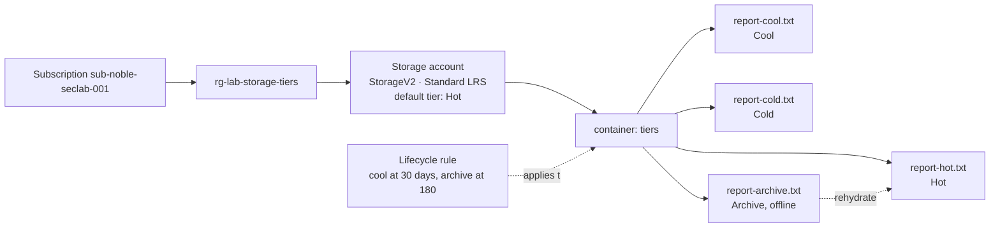

# storage tiers

> **Intent:** Find the real cost and latency differences between hot, cool, cold and archive tiers, and what rehydrating an archived blob actually involves.

## What this lab is

Azure Blob Storage keeps files ("blobs") in four **access tiers**. The colder
the tier, the cheaper it is to *store* a file and the dearer it is to *read*
it back. Archive is so cold the file is offline: it cannot be read at all until
Azure brings it back, which takes hours.

Picking the wrong tier is one of the easiest ways to waste money in Azure,
either by paying hot prices for data nobody reads, or by archiving data that
then has to be pulled back in a hurry.

## Questions

1. **What does each tier really cost:** to store a file, and to read it back?
2. **What happens when you try to open an archived file,** and what does it
   take, in time and money, to get it back?
3. **What does moving a file to a colder tier too early cost?** Cool, cold and
   archive each have a minimum stay.
4. **Once the account's master keys are switched off, who can still read the
   files?** Owner manages the account, but reading data needs a separate data
   role. (Added mid-lab after spotting that the portal quietly uses the key.)

### Predictions (written before building)

| # | My prediction | What actually happened |
|---|---|---|
| 1 | Cool. |  |
| 2 | It is first moved out of archive, through cold and cool to hot, and only then can be read. |  |
| 3 | You pay for one day. |  |
| 4 | *(made before part 4)* |  |

## Key ideas, from zero

| Term | Plain meaning |
|---|---|
| **Storage account** | The top-level container for storage in Azure. Its name becomes part of a public web address, so it must be unique worldwide. |
| **Container** | A folder inside the account that holds blobs. |
| **Blob** | One file. |
| **Access tier** | Hot, Cool, Cold or Archive. Set per blob; the account has a default for new blobs. |
| **Hot** | Data read often. Highest storage price, lowest read price. |
| **Cool / Cold** | Data read rarely. Cheaper to store, dearer to read, with a minimum stay (cool 30 days, cold 90). |
| **Archive** | Data almost never read. Cheapest to store, **offline**, minimum stay 180 days. |
| **Rehydration** | Bringing an archived blob back online by moving it to a warmer tier. Standard priority can take up to 15 hours; High priority is faster and costs more. |
| **Early deletion charge** | Move or delete a blob before its tier's minimum stay and you pay for the remaining days anyway. |
| **Lifecycle management** | Rules that move or delete blobs automatically by age, e.g. "cool after 30 days, archive after 180". |
| **Redundancy (LRS)** | How many copies Azure keeps. Locally redundant storage keeps three copies in one datacentre: the cheapest option, and one that supports the archive tier. |

## Architecture



## What gets built

| Resource | SKU / setting | Why it's here |
|---|---|---|
| `rg-lab-storage-tiers` | resource group, East US | holds the lab |
| Storage account | StorageV2, Standard, **LRS**, default tier Hot | LRS is the cheapest redundancy that supports archive |
| Container `tiers` | private | no anonymous access |
| Four small text files | one per tier | the same file in each tier, so only the tier differs |
| Lifecycle management rule | cool at 30 days, archive at 180 | the automated version of moving tiers by hand |

## Build it in the portal

<!--
The primary record. Numbered steps covering the decisions, not every click.
Note anything the portal defaulted to that you had to think about, and why
you chose what you chose. Screenshots go in screenshots/ and are referenced
inline where they clarify something.
-->

1.
2.
3.

## Break it

<!--
Deliberately misconfigure one thing and record the failure mode. This is
where most of the learning happens and it is the part people skip.
What did you break, what error appeared, how did you diagnose it?
-->

## Rebuild it as code

Export the portal's template first to see what Azure created:

```bash
az group export --name rg-lab-storage-tiers > exported-reference.json
```

Then write `bicep/main.bicep` yourself and deploy to a clean group:

```bash
az group create --name rg-lab-storage-tiers-iac --location eastus \
  --tags environment=lab purpose=lab lab=storage-tiers autoDelete=true

az deployment group create \
  --resource-group rg-lab-storage-tiers-iac \
  --template-file bicep/main.bicep
```

## What I found

<!--
The answer to the question above, in your own words. Include anything that
surprised you, anything the documentation got wrong or left out, and the
one sentence you would want to read back later.
-->

## Cost

A few cents. The files are tiny, and storage is billed per GB per month. The one
trap is the **early deletion charge**: deleting the archived file at teardown
bills its remaining 180 days, which for a file of a few kilobytes is a fraction
of a cent. That charge is part of what this lab measures.

## Teardown

```bash
az group delete --name rg-lab-storage-tiers --yes --no-wait
az group delete --name rg-lab-storage-tiers-iac --yes --no-wait
```
