# storage tiers

> **Intent:** Find the real cost and latency differences between hot, cool, cold and archive tiers, and what rehydrating an archived blob actually involves.

## What this lab is

Azure Blob Storage keeps files ("blobs") in four **access tiers**. The colder
the tier, the cheaper it is to *store* a file and the dearer it is to *read*
it back. Archive is so cold the file is offline: it cannot be read at all until
Azure brings it back, which takes hours.

Picking the wrong tier is one of the easiest ways to waste money in Azure,
either by paying hot prices for data nobody reads, or by archiving data that
then has to be pulled back in a hurry.

## Questions

1. **What does each tier really cost:** to store a file, and to read it back?
2. **What happens when you try to open an archived file,** and what does it
   take, in time and money, to get it back?
3. **What does moving a file to a colder tier too early cost?** Cool, cold and
   archive each have a minimum stay.
4. **Once the account's master keys are switched off, who can still read the
   files?** Owner manages the account, but reading data needs a separate data
   role. (Added mid-lab after spotting that the portal quietly uses the key.)

### Predictions (written before building)

| # | My prediction | What actually happened |
|---|---|---|
| 1 | Cool. |  |
| 2 | It is first moved out of archive, through cold and cool to hot, and only then can be read. | Half right. It cannot be read until it is brought back online (step 4), but there is no stepping through tiers: it goes straight to whichever online tier is chosen. |
| 3 | You pay for one day. |  |
| 4 | *(made before part 4)* |  |

## Key ideas, from zero

| Term | Plain meaning |
|---|---|
| **Storage account** | The top-level container for storage in Azure. Its name becomes part of a public web address, so it must be unique worldwide. |
| **Container** | A folder inside the account that holds blobs. |
| **Blob** | One file. |
| **Access tier** | Hot, Cool, Cold or Archive. Set per blob; the account has a default for new blobs. |
| **Hot** | Data read often. Highest storage price, lowest read price. |
| **Cool / Cold** | Data read rarely. Cheaper to store, dearer to read, with a minimum stay (cool 30 days, cold 90). |
| **Archive** | Data almost never read. Cheapest to store, **offline**, minimum stay 180 days. |
| **Rehydration** | Bringing an archived blob back online by moving it to a warmer tier. Standard priority can take up to 15 hours; High priority is faster and costs more. |
| **Early deletion charge** | Move or delete a blob before its tier's minimum stay and you pay for the remaining days anyway. |
| **Lifecycle management** | Rules that move or delete blobs automatically by age, e.g. "cool after 30 days, archive after 180". |
| **Redundancy (LRS)** | How many copies Azure keeps. Locally redundant storage keeps three copies in one datacentre: the cheapest option, and one that supports the archive tier. |

## Architecture

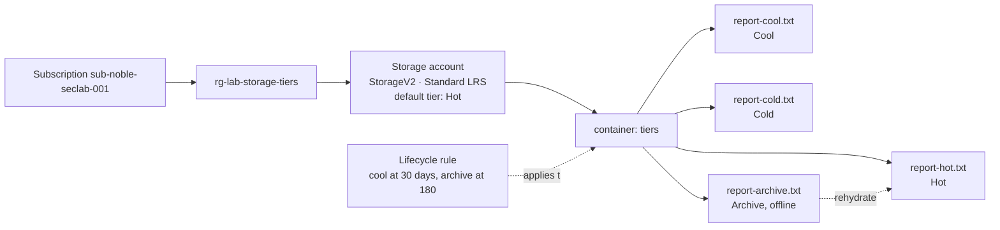

## What gets built

| Resource | SKU / setting | Why it's here |
|---|---|---|
| `rg-lab-storage-tiers` | resource group, East US | holds the lab |
| Storage account | StorageV2, Standard, **LRS**, default tier Hot | LRS is the cheapest redundancy that supports archive |
| Container `tiers` | private | no anonymous access |
| Four small text files | one per tier | the same file in each tier, so only the tier differs |
| Lifecycle management rule | cool at 30 days, archive at 180 | the automated version of moving tiers by hand |

## Build it in the portal

### 1. Create the storage account

`stlabtiersnoble01` in a new group `rg-lab-storage-tiers`, East US. The
portal now asks for a **primary service** (Blob Storage) and a **primary
workload**; **General purpose** was chosen because the workload presets quietly
change defaults on later tabs. Choosing it also reset the resource group to
`NetworkWatcherRG`, which had to be put back: re-check earlier fields after
changing a preset.

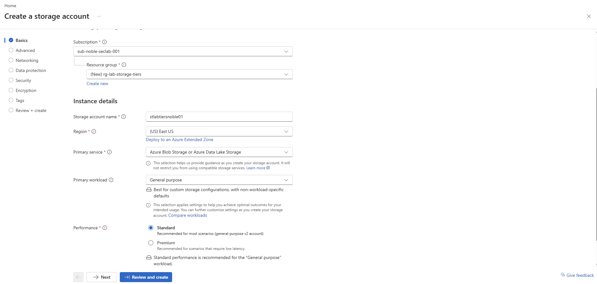

Standard performance, **LRS** redundancy (three copies in one datacentre: the
cheapest, and it supports archive). The portal recommends RA-GRS for general
purpose, which copies to a second region; a lab does not need it.

**The default access tier offers Hot, Cool and Cold, but not Archive.** The
account default applies to every new blob, and an archived blob is offline, so
it cannot be the default. Archive is set per blob.

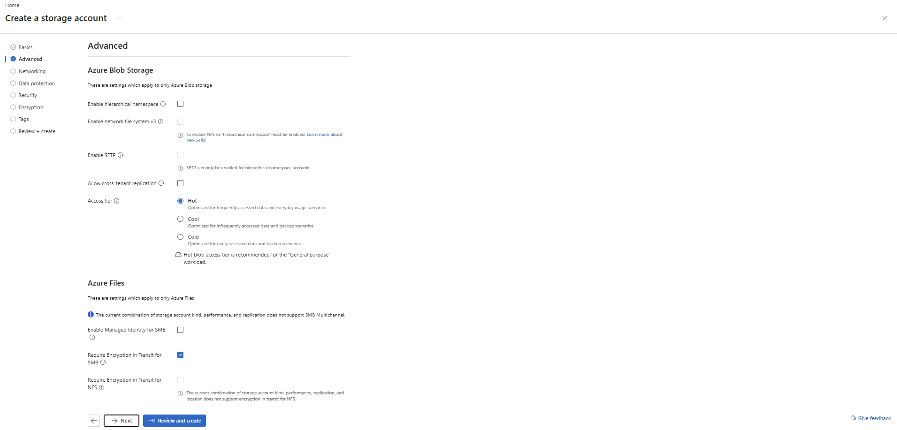

The other tabs, and why each was left as it was:

| Tab | Setting | Why |
|---|---|---|
| Advanced | Hierarchical namespace **off** | Real folders (Data Lake Gen2) are for analytics; cannot be turned off once on |
| Networking | Public network access, all networks | Reachable is not readable: every request still needs a key or a sign-in. Private access is lab 15 |
| Data protection | Soft delete 7 days on; versioning, change feed, immutability off | A recycle bin, without extra copies that would cloud the tier results. Soft-deleted data is still billed |
| Security | Anonymous access **off** (now the default), secure transfer, TLS 1.2 | No unauthenticated reads |
| Security | Storage account key access **on** | Kept on for now; part 4 turns it off |
| Encryption | Microsoft-managed keys | Data is always encrypted at rest; this only decides who holds the key |

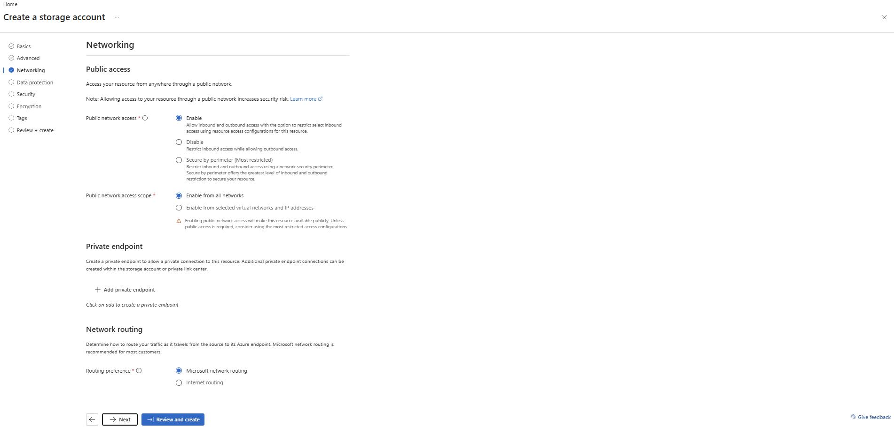
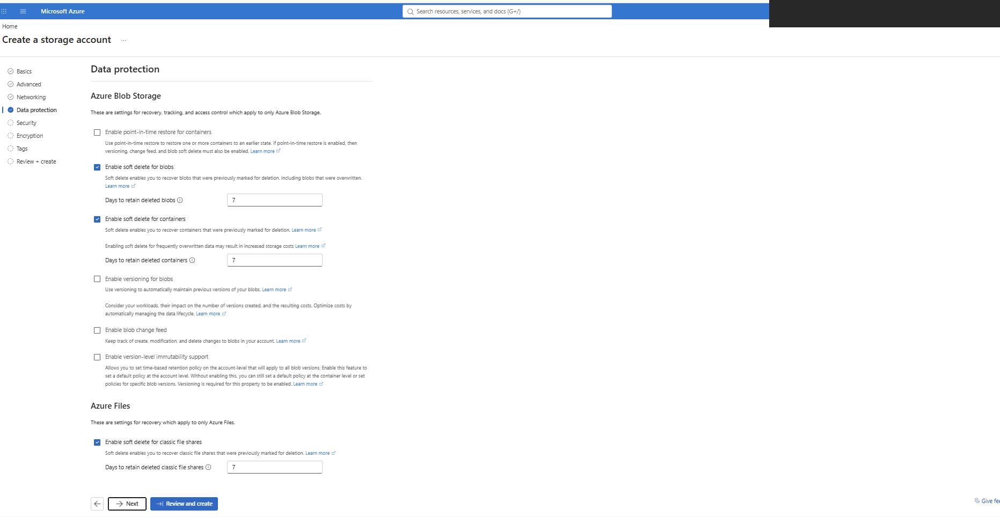
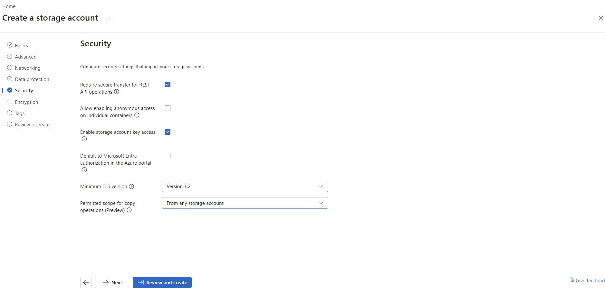
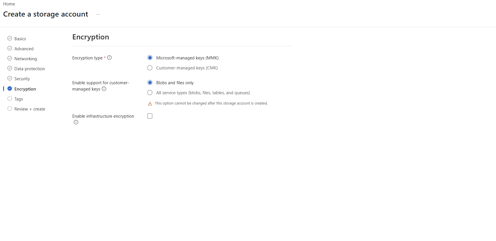
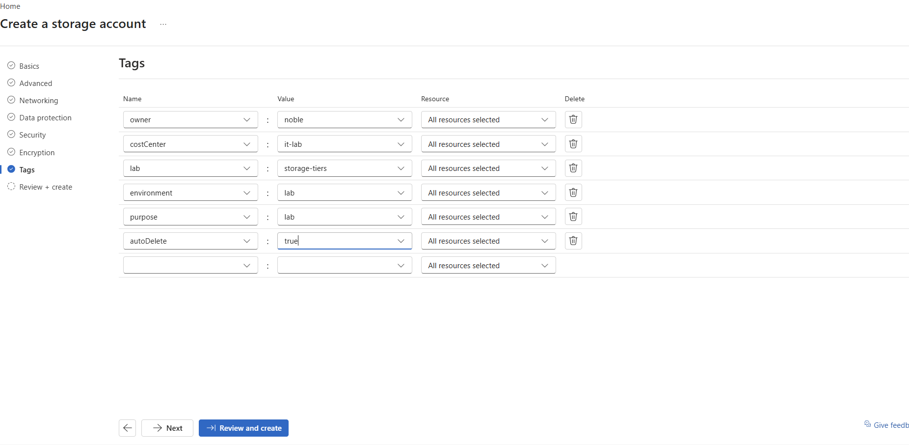

The review page shows the six tags applied to the storage account **and** to
resource types this deployment did not create (virtual network, private
endpoint): the portal's tag picker defaults to "all resources selected" for
anything the template could include.

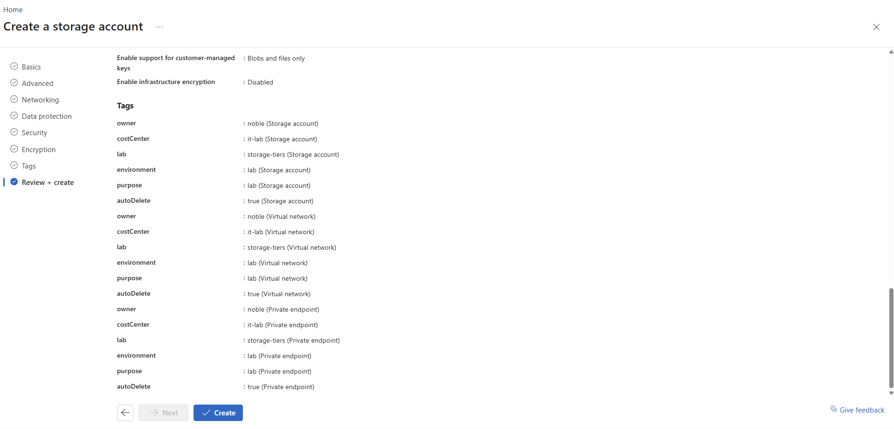
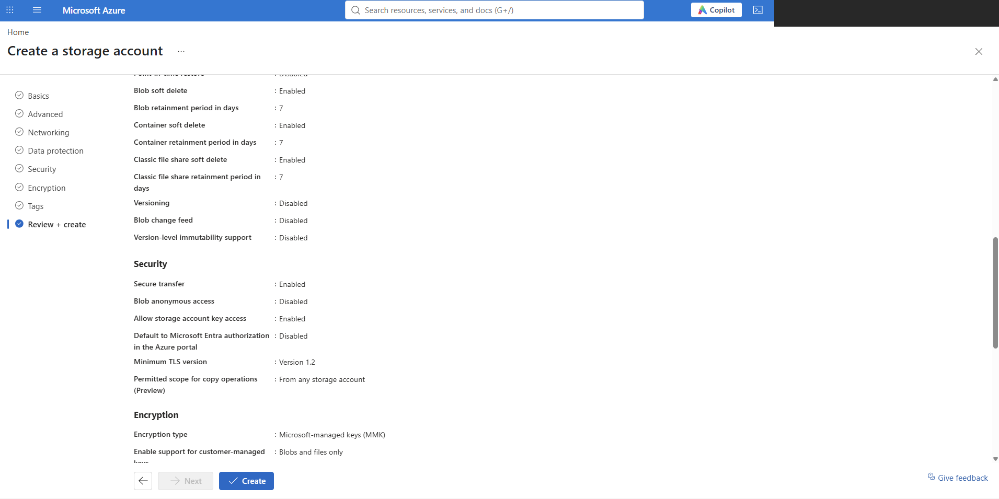

### 2. Create a container

A container is the top-level grouping for blobs: a security boundary (access
can be granted per container), a boundary for lifecycle and immutability rules,
and the equivalent of an S3 bucket. Containers do not nest.

`tiers` was created **Private**, and the access level was greyed out because
anonymous access is off for the whole account.

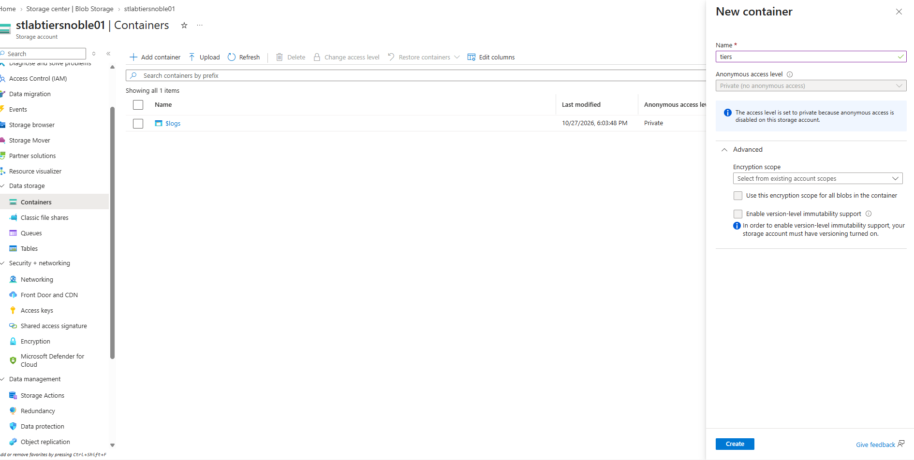

A second container, **`$logs`**, appeared without being created. It is a
system container Azure reserves for storage analytics logs.

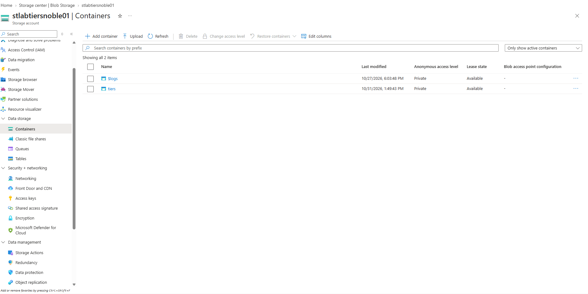

### 3. Upload one file per tier

The four files in [`sample-files/`](sample-files/) are identical apart from one
word, so the only real difference between them is the tier. Each was uploaded
on its own, with the tier set under **Advanced**.

The tier list offers **Hot (Inferred)** as well as **Hot**. *Inferred* means
the blob has no tier of its own and follows the account default; if that
default later changed to Cool, the blob would silently change with it. Plain
**Hot** pins the tier to the blob. **Archive** is offered here, per blob, even
though the account default cannot be Archive. **Smart** (automatic tiering by
access pattern) was listed but greyed out.

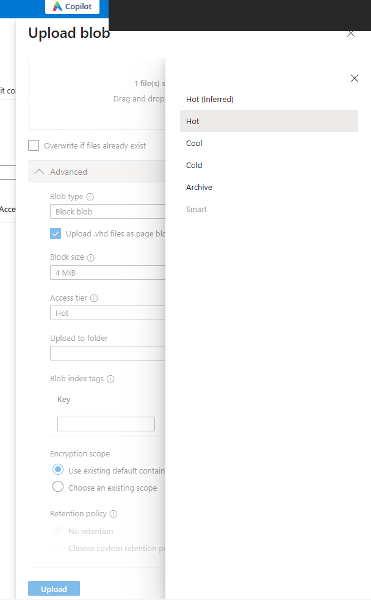

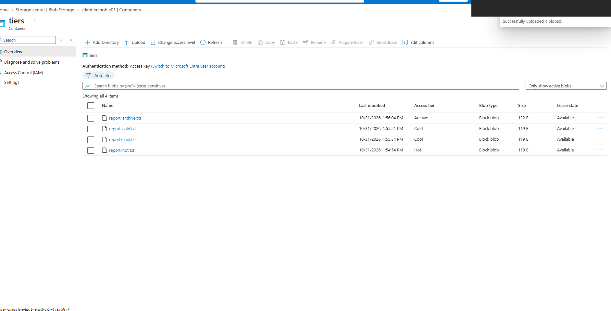

The container page reads **Authentication method: Access key**: the portal was
using the account's master key behind the scenes, not the signed-in user.

### 4. Try to open each file

Hot, Cool and Cold all opened in the portal editor straight away, with the same
content. From the reader's side, the online tiers behave identically; only the
bill differs.

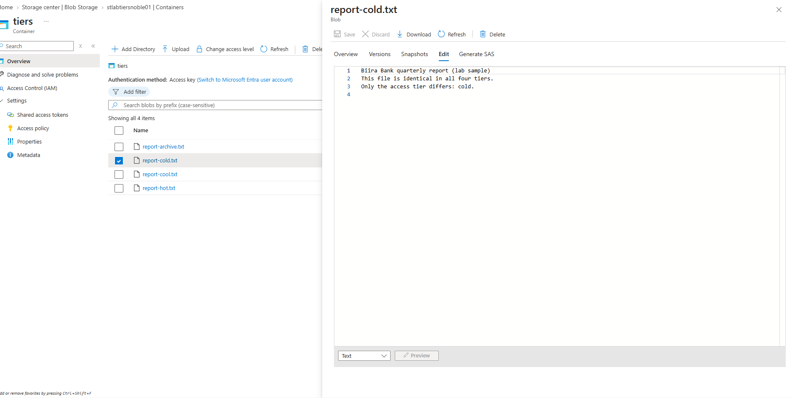
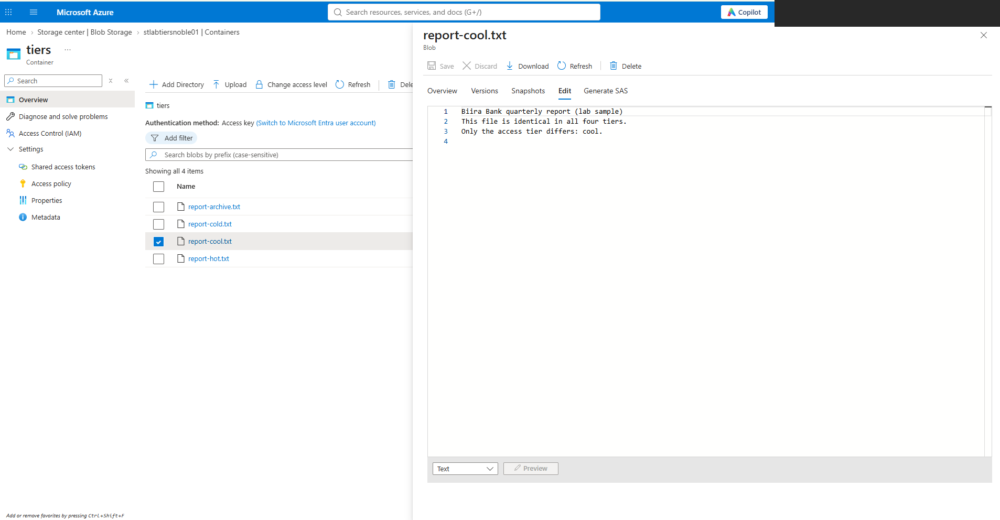
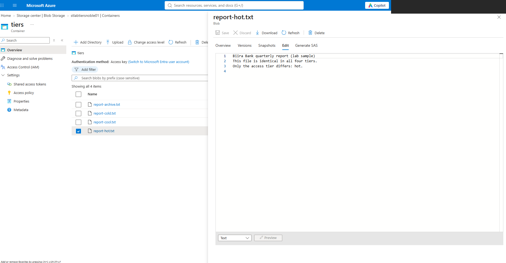

The archived file did not open, and would not download:

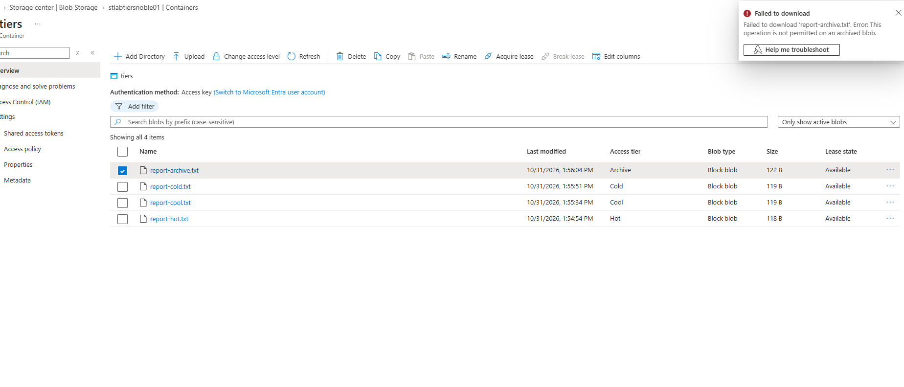

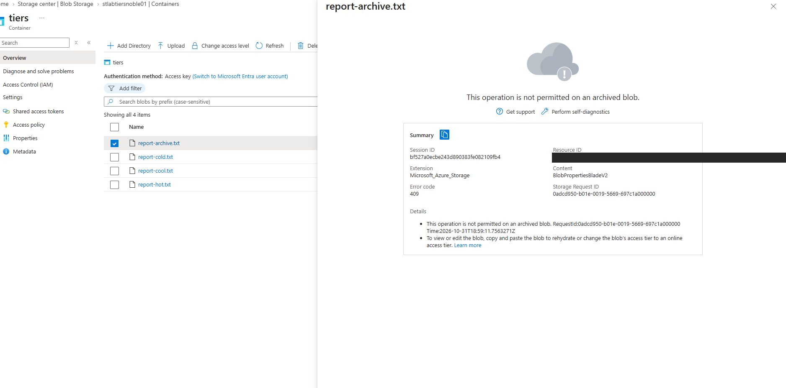

> This operation is not permitted on an archived blob. To view or edit the blob,
> copy and paste the blob to rehydrate or change the blob's access tier to an
> online access tier.

The data is still there and still billed; it is offline. The message also names
the **two** ways back: change the blob's tier, or copy it to a new blob in an
online tier. Neither steps through Cold and Cool on the way: the target can be
any online tier directly.

## Break it

<!--
Deliberately misconfigure one thing and record the failure mode. This is
where most of the learning happens and it is the part people skip.
What did you break, what error appeared, how did you diagnose it?
-->

## Rebuild it as code

Export the portal's template first to see what Azure created:

```bash
az group export --name rg-lab-storage-tiers > exported-reference.json
```

Then write `bicep/main.bicep` yourself and deploy to a clean group:

```bash
az group create --name rg-lab-storage-tiers-iac --location eastus \
  --tags environment=lab purpose=lab lab=storage-tiers autoDelete=true

az deployment group create \
  --resource-group rg-lab-storage-tiers-iac \
  --template-file bicep/main.bicep
```

## What I found

<!--
The answer to the question above, in your own words. Include anything that
surprised you, anything the documentation got wrong or left out, and the
one sentence you would want to read back later.
-->

## Cost

A few cents. The files are tiny, and storage is billed per GB per month. The one
trap is the **early deletion charge**: deleting the archived file at teardown
bills its remaining 180 days, which for a file of a few kilobytes is a fraction
of a cent. That charge is part of what this lab measures.

## Teardown

```bash
az group delete --name rg-lab-storage-tiers --yes --no-wait
az group delete --name rg-lab-storage-tiers-iac --yes --no-wait
```
