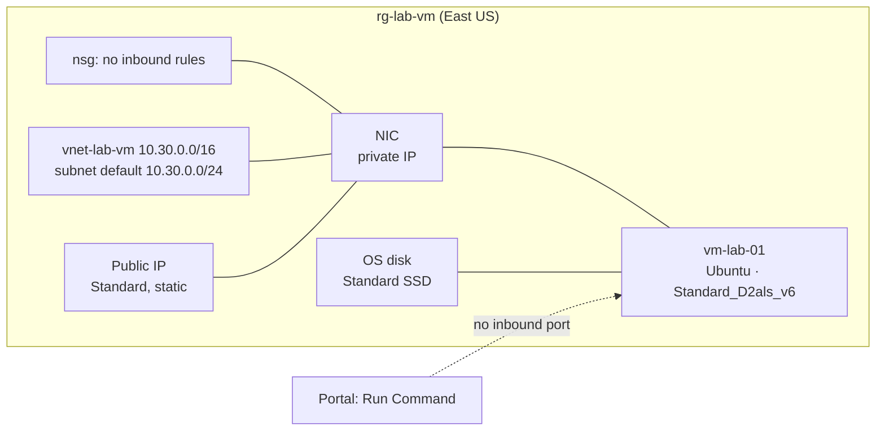
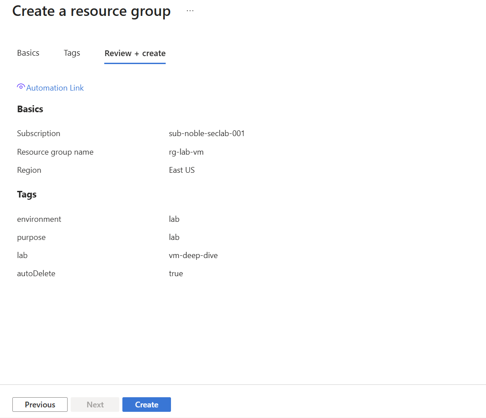

# VM deep dive

> **Intent:** Settle what a VM is made of (size family, disks, NIC, IP) and prove the billing difference between shutting down inside the OS and deallocating from Azure.

> **Status:** in progress.

## What this lab is

A virtual machine looks like one thing in the portal, but Azure builds it from
several separate resources: the compute (a **size**), an **OS disk**, a
**network interface** in a subnet, usually a **public IP** and a **network
security group**. Each is billed and deleted on its own terms, which is where
most VM surprises on a bill come from.

The lab builds one small Linux VM with **no inbound ports open at all**,
manages it without SSH, and then tests the two ways of "turning it off".

## Questions

1. **What is a VM actually made of?** Which separate resources appear in the
   resource group, and which of them still cost money when the VM is off?
2. **Is shutting down from inside the OS the same as stopping it in Azure?**
   Which one stops the compute charge?
3. **What survives a deallocate?** The OS disk, the temporary disk, the public
   IP address, the private IP address.

### Predictions (written before building)

| # | My prediction | What actually happened |
|---|---|---|
| 1 | When the VM is off, the disk still costs money (not sure what else). |  |
| 2 | Shutting down from inside Linux stops the compute charge; only the disk keeps billing. |  |
| 3 | A file on the temporary disk (`/mnt`) does not survive: it is ephemeral storage. |  |

## Key ideas, from zero

| Term | Plain meaning |
|---|---|
| **Size** | The VM's CPU and memory, e.g. `Standard_B2ats_v2` (2 vCPU, 1 GiB) or `Standard_D2als_v6` (2 vCPU, 4 GiB). The family letter says what it is for; **B** is burstable: cheap, banks CPU credits when idle. |
| **OS disk** | A managed disk holding the operating system. Survives stop and deallocate; billed while it exists. |
| **Temporary disk** | Fast local storage on the physical host, mounted at `/mnt` on Linux. **Wiped** when the VM moves to another host. |
| **NIC** | Network interface: connects the VM to a subnet and holds its private IP. |
| **Public IP** | A separate resource. Standard SKU, static: billed per hour whether the VM runs or not. |
| **NSG** | Network security group: inbound and outbound allow/deny rules. |
| **Stopped** | Shut down from inside the OS: the VM still holds its place on the host. |
| **Stopped (deallocated)** | Stopped from Azure: the host is released. |
| **Run Command** | Runs a script inside the VM through the Azure agent, with no inbound port needed. |
| **Auto-shutdown** | A daily deallocate at a set time: the safety net against a forgotten lab VM. |

## Architecture



## What gets built

| Resource | SKU / setting | Why it's here |
|---|---|---|
| `rg-lab-vm` | resource group, East US | holds the lab |
| `vm-lab-01` | Ubuntu Server 24.04 LTS, `Standard_D2als_v6` | the cheapest x64 size with quota (see step 2) |
| OS disk | Standard SSD | survives stop and deallocate; still billed |
| Virtual network, NIC, public IP, NSG | created with the VM | to see each as its own resource |
| Inbound ports | **none** | managed through Run Command, never exposed to the internet |
| Auto-shutdown | daily | the safety net |

## Build it in the portal

<!--
The primary record. Numbered steps covering the decisions, not every click.
Note anything the portal defaulted to that you had to think about, and why
you chose what you chose. Screenshots go in screenshots/ and are referenced
inline where they clarify something.
-->

### 1. Create the resource group

`rg-lab-vm` in East US with the lab tags; the lab 01 policy adds `costCenter`
on its own (Figure 3.1).



*Figure 3.1: Review + create for rg-lab-vm.*

### 2. Choose a size, and meet quota

The create form defaulted to **Standard_D2s_v3 at $70.08 a month**, about ten
times what a lab VM needs. The plan was a B-series burstable size, and that is
where the lab hit its first real wall:

- `Standard_B1s` is no longer offered in East US for this subscription.
- `Standard_B2ats_v2` ($6.86 a month) was listed but greyed out:
  *Insufficient quota - family limit*. The subscription's quota for the
  **Basv2 family was 0 vCPUs**, while most D, E and F families had 10.
- The automatic quota increase to 4 vCPUs was **refused**, so a support
  request (Basic plan, severity C) went to Microsoft instead.

Quota is a ceiling on how many vCPUs of a family can run at once, per region.
It costs nothing to hold, and keeping it low is a guardrail: nothing can start
ten VMs by mistake. Rather than wait on the ticket, the lab uses the cheapest
x64 size that already had quota:

| Size | Per hour | Per month if never stopped |
|---|---:|---:|
| Standard_B2ats_v2 (no quota) | $0.0094 | $6.86 |
| **Standard_D2als_v6** (chosen) | **$0.0804** | $58.69 |
| Standard_D2s_v3 (portal default) | | $70.08 |

At a few hours of running time, deallocated in between, the difference is
cents; the monthly figure only matters for a VM that is left on.

## Break it

<!--
Deliberately misconfigure one thing and record the failure mode. This is
where most of the learning happens and it is the part people skip.
What did you break, what error appeared, how did you diagnose it?
-->

## Rebuild it as code

Export the portal's template first to see what Azure created:

```bash
az group export --name rg-lab-vm > exported-reference.json
```

Then write `bicep/main.bicep` yourself and deploy to a clean group:

```bash
az group create --name rg-lab-vm-iac --location eastus \
  --tags environment=lab purpose=lab lab=vm-deep-dive autoDelete=true

az deployment group create \
  --resource-group rg-lab-vm-iac \
  --template-file bicep/main.bicep
```

## What I found

<!--
The answer to the question above, in your own words. Include anything that
surprised you, anything the documentation got wrong or left out, and the
one sentence you would want to read back later.
-->

## Cost

`Standard_D2als_v6` is about 8 cents per hour of compute while running. The disk and
the public IP keep billing while the VM is stopped or deallocated, which is
the point of question 1. Auto-shutdown and deallocating between sessions keep
the lab to cents.

## Teardown

```bash
az group delete --name rg-lab-vm --yes --no-wait
az group delete --name rg-lab-vm-iac --yes --no-wait
```
