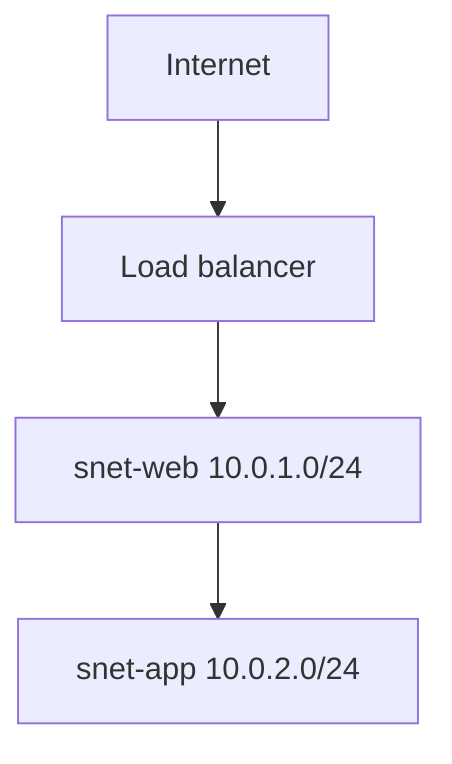

# azure files share

## What this lab is

<!--
Two or three sentences in plain language. What Azure service or pattern is
this about, and why does it matter in a real environment? Write this as if
explaining to a colleague who knows infrastructure but not Azure.
-->

## Question

<!--
The specific thing you want to find out. A lab without a question is a
tutorial you followed. Examples:
  - What is the billing difference between stopping a VM from inside the OS
    and deallocating it from Azure?
  - Does a subnet NSG apply to traffic between two VMs in that same subnet?
-->

## Architecture


<!--
Draw it in draw.io using the Azure icon set (More Shapes > Networking > Azure).
Save the source as diagrams/architecture.drawio and export a PNG alongside it.

For a quick structural view, a Mermaid block renders natively on GitHub:


-->

## What gets built

| Resource | SKU / size | Why it's here |
|---|---|---|
|  |  |  |

## Build it in the portal

<!--
The primary record. Numbered steps covering the decisions, not every click.
Note anything the portal defaulted to that you had to think about, and why
you chose what you chose. Screenshots go in screenshots/ and are referenced
inline where they clarify something.
-->

1.
2.
3.

## Break it

<!--
Deliberately misconfigure one thing and record the failure mode. This is
where most of the learning happens and it is the part people skip.
What did you break, what error appeared, how did you diagnose it?
-->

## Rebuild it as code

Export the portal's template first to see what Azure created:

```bash
az group export --name rg-lab-azure-files-share > exported-reference.json
```

Then write `bicep/main.bicep` yourself and deploy to a clean group:

```bash
az group create --name rg-lab-azure-files-share-iac --location eastus \
  --tags environment=lab purpose=az104-study lab=azure-files-share autoDelete=true

az deployment group create \
  --resource-group rg-lab-azure-files-share-iac \
  --template-file bicep/main.bicep
```

## What I found

<!--
The answer to the question above, in your own words. Include anything that
surprised you, anything the documentation got wrong or left out, and the
one sentence you would want to read back before the exam.
-->

## Exam relevance

<!-- Which AZ-104 objective this maps to, and what a question on it looks like. -->

## Cost

<!-- Rough cost per hour while running, and what the expensive resource is. -->

## Teardown

```bash
az group delete --name rg-lab-azure-files-share --yes --no-wait
az group delete --name rg-lab-azure-files-share-iac --yes --no-wait
```
